# YTMusicDownloader

Self-hosted music library manager that pulls songs from YouTube Music, fetches synced lyrics, and files everything into a clean, media-server-ready folder structure. Follow an artist once and every new release lands in your library automatically.

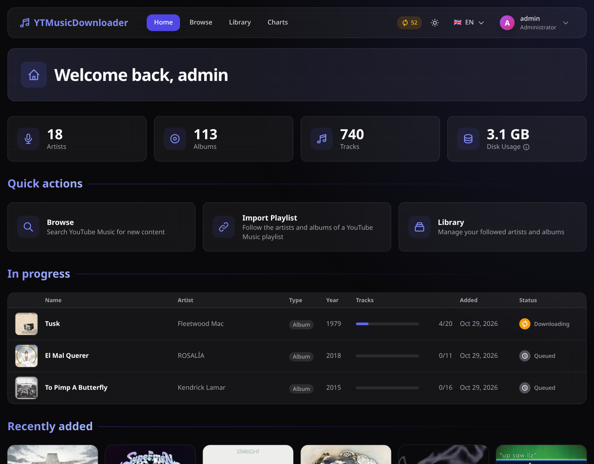

## Features

- **Search YouTube Music** for artists, albums and tracks from a web UI.
- **Follow artists**: all existing releases are downloaded, and new ones are picked up automatically.
- **Download single albums** without following the artist.
- **Playlists**: paste a YouTube Music playlist URL, then follow every artist in it or download every album it contains in bulk, or add the playlist to the library: followed (new songs bring in their albums or artists), and/or written as an M3U file that Jellyfin picks up as a playlist.
- **Charts**: follow a country's music chart and automatically follow its top N artists (re-synced weekly).
- **Synced lyrics** from [LRCLIB](https://lrclib.net), saved as `.lrc` sidecar files. Missing lyrics are retried daily; plain lyrics are upgraded to synced when they become available. Lyrics can also be viewed and edited by hand in the UI.
- **Library overview**: download progress for every followed artist and album, plus library stats, with disk usage summed from the actual sizes of the downloaded audio files.
- **Tagged audio**: M4A/AAC files with title, album, artist, album artist, track number, year, genres and embedded cover art.
- **Genres** from [MusicBrainz](https://musicbrainz.org) (specific, community-voted) with [Deezer](https://www.deezer.com) as a fallback, written to the tags and NFO files so Jellyfin can browse and mix by genre. No account or API key needed.
- **Recommendations**: artists similar to the ones you like, from YouTube Music's own "Fans might also like", ranked by how many of your artists point to them. Personal to each user.
- **Jellyfin-friendly layout** with `artist.nfo`, `album.nfo`, `folder.jpg`, `backdrop.jpg` and `cover.jpg`.
- **Multi-user** with three roles (visitor / member / administrator), optional public registration, optional [single sign-on](#single-sign-on-oidc) through your identity provider (Authelia, Authentik, Pocket ID, Keycloak…), and httpOnly-cookie sessions.
- **Rate-limit aware**: detects YouTube throttling and bot checks, resets its session, and pauses all downloads with exponential backoff instead of hammering YouTube.
- **Age-restricted tracks** supported via an optional cookies.txt from a signed-in YouTube account (used *only* for those tracks).
- **Backup / restore**: export your followed artists, albums and charts (or a full backup with users and settings) as JSON and import it on another instance, with a dry-run preview.
- **Light / dark theme**, multi-language UI, responsive layout.

## Screenshots

| | |
|:---:|:---:|
| **Browse**: search YouTube Music, or import a playlist<br>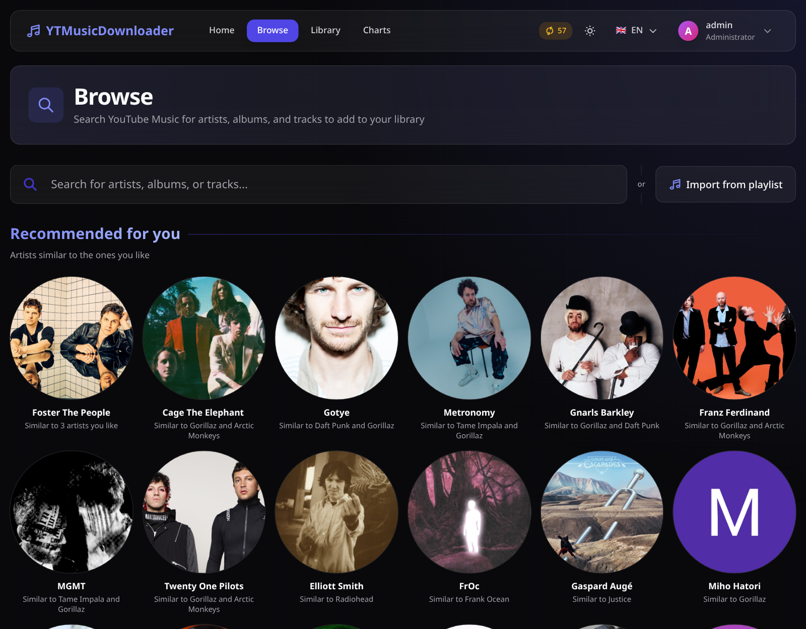 | **Artist**: follow once, every release is tracked<br>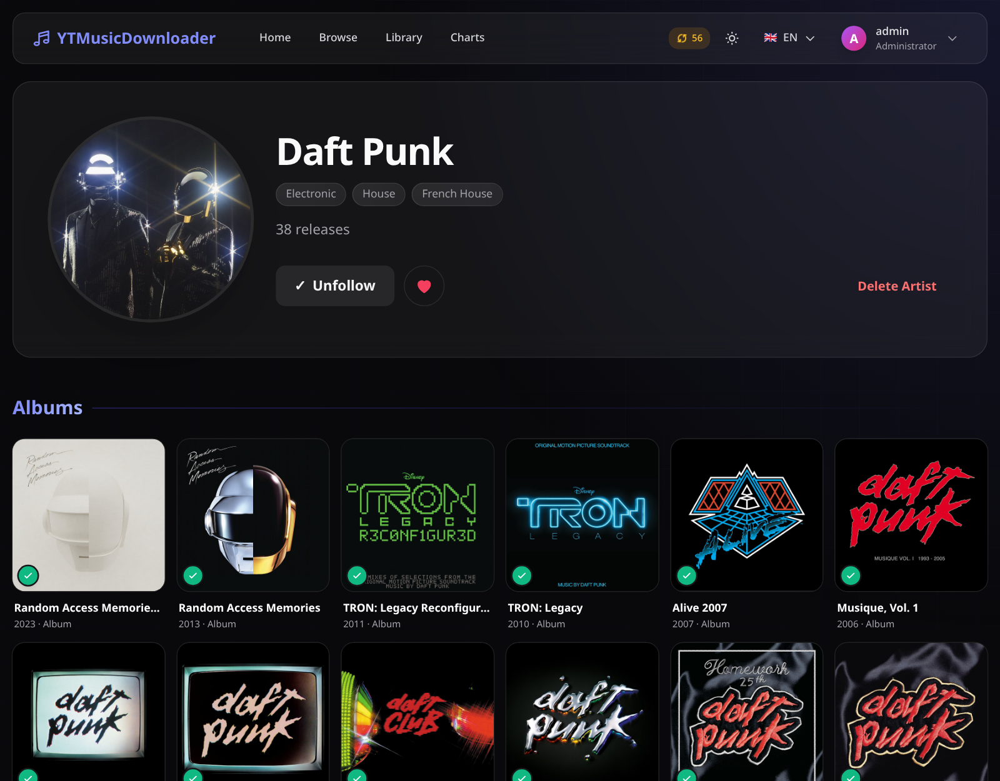 |
| **Album**: per-track download and lyrics status<br>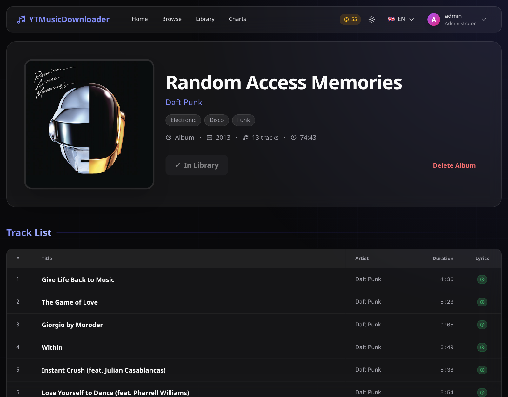 | **Lyrics editor**: view, paste or fix lyrics by hand<br>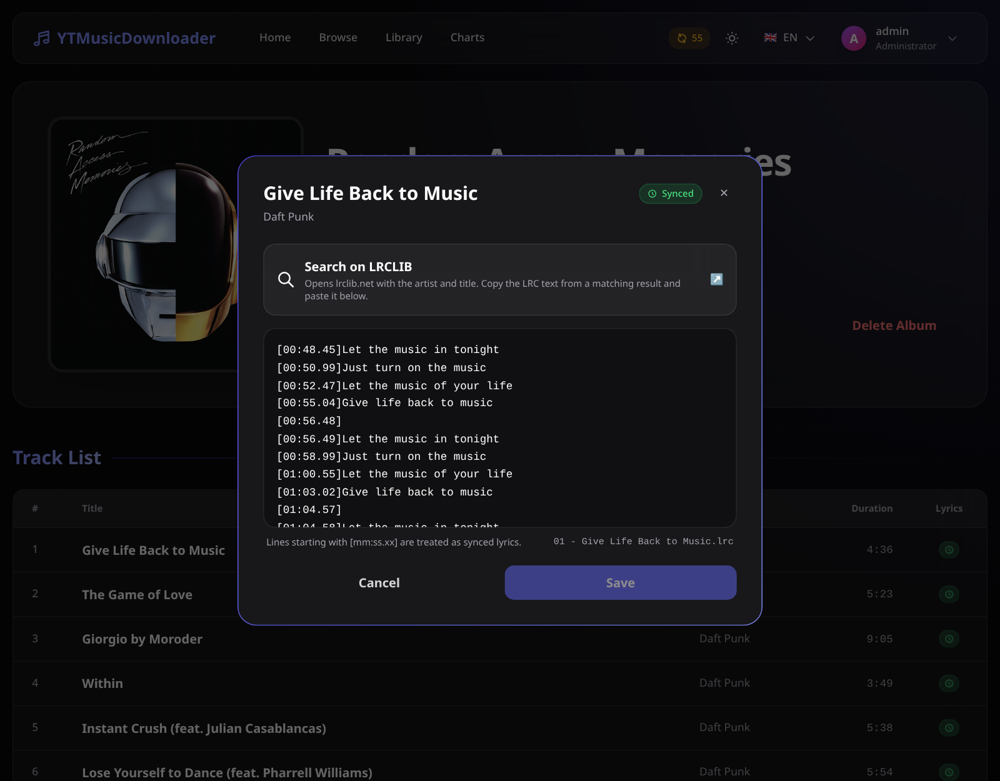 |
| **Library**: progress for every followed artist and album<br>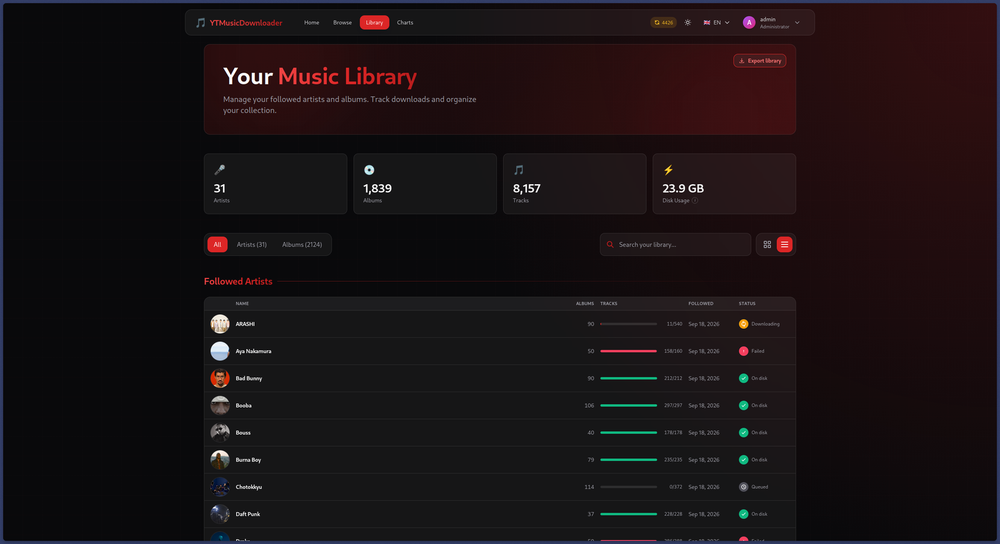 | **Charts**: auto-follow the top artists of a country<br>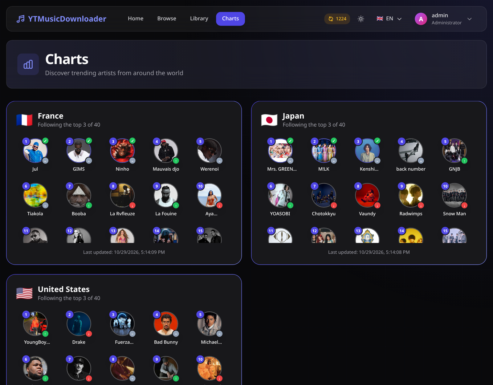 |
| **Admin panel**: backup and restore, users, charts, settings<br>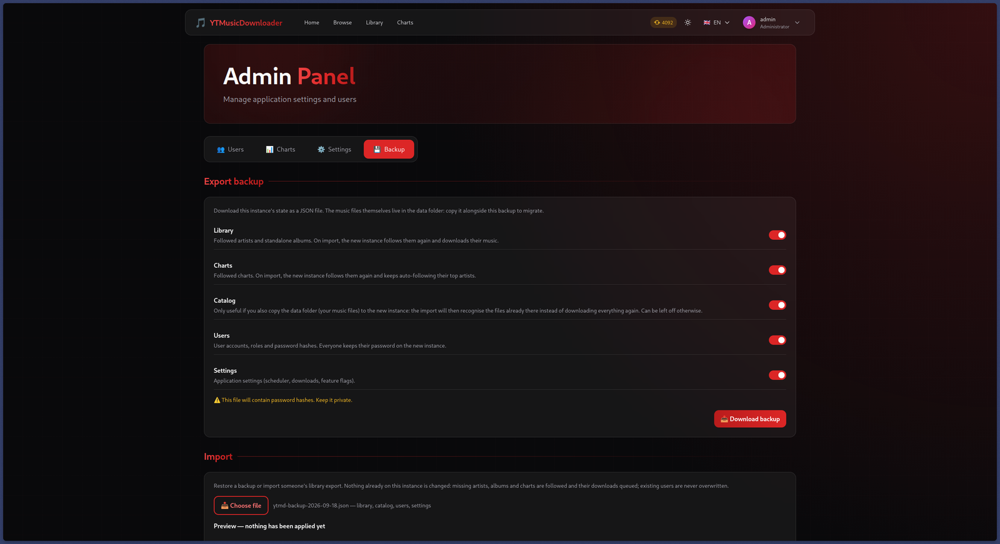 | **Light theme**<br>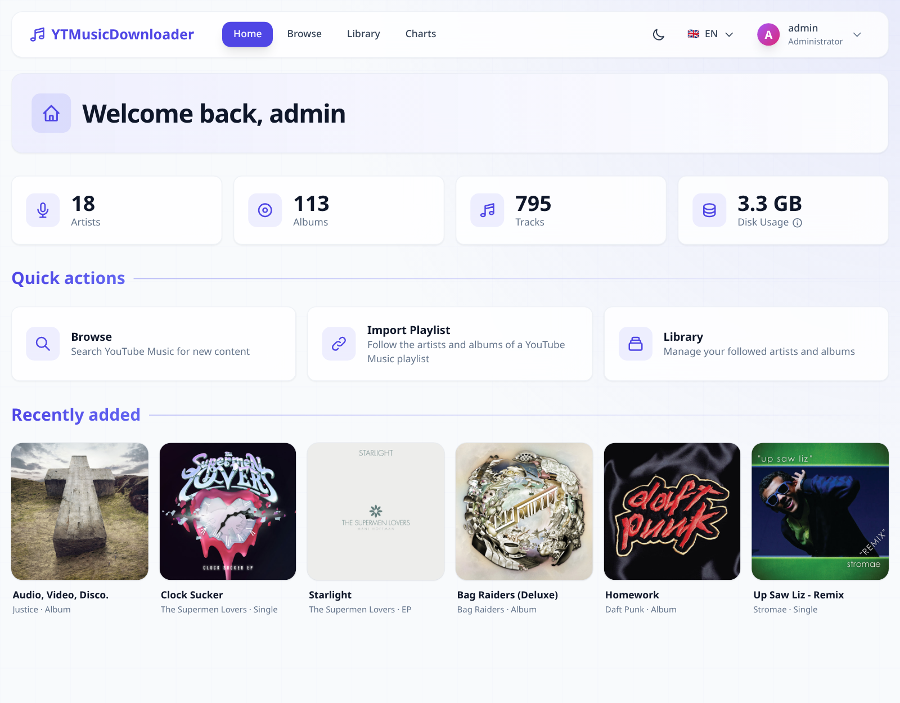 |

<details>
<summary>Mobile</summary>
<p align="center">
  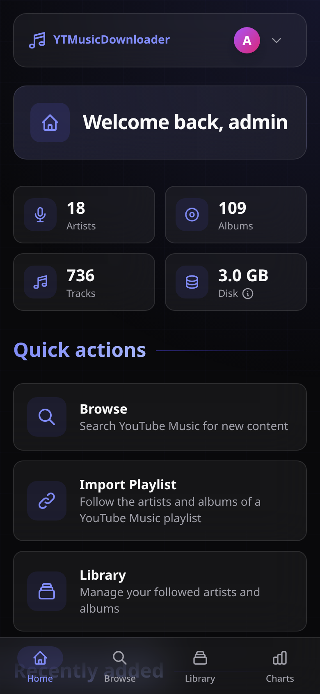
  &nbsp;&nbsp;
  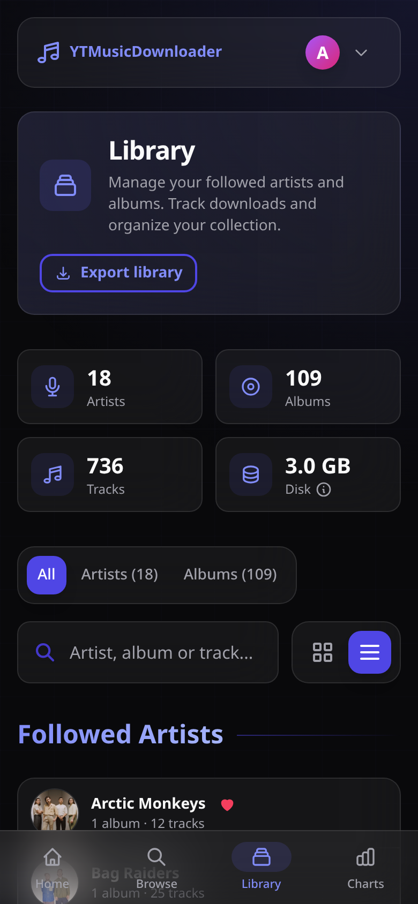
</p>
</details>

## Quick start

Requirements: Docker and Docker Compose.

```bash
git clone https://github.com/patato0705/YTMusicDownloader.git
cd YTMusicDownloader
docker compose up -d --build
```

On its first start (empty database), the app creates an administrator named `admin` with a generated password, printed once in the log.

Open <http://localhost:8000> and sign in with it. Lost the log? See [Recovering access](#recovering-access).

The first build takes a few minutes (frontend build + Python dependencies). Subsequent starts are fast.

### Directories

| Host path | Container path | Contents |
|---|---|---|
| `./config` | `/config` | SQLite database, `secrets.json` (JWT secret), logs, caches, temp downloads, YouTube cookie jars, artwork for artists and albums that aren't downloaded (`covers/`) |
| `./data` | `/data` | Your music library |

Both are created on first start if missing. Back up `./config` together with `./data`. Losing `secrets.json` logs everyone out. Losing the database loses the library index (though the *Backup* tab in the admin panel gives you a portable alternative, see below).

### Library layout

Files are written to `/data` (bind-mounted from `./data` by default):

```
data/
└── Artist Name/
    ├── artist.nfo
    ├── folder.jpg
    ├── backdrop.jpg
    └── Album Title/
        ├── album.nfo
        ├── cover.jpg
        ├── 01 - Track Title.m4a
        ├── 01 - Track Title.lrc
        ├── 02 - Track Title.m4a
        └── ...
```

Names are sanitised for the filesystem. Point Jellyfin (or any media server that reads NFO files and folder art) at this directory.

### File ownership

The app runs as `PUID:PGID` inside the container (default `1000:1000`), so files it writes to `./config` and `./data` are owned by that user on the host. If `id -u` / `id -g` on your host give different numbers, set them in `docker-compose.yml`.

## Configuration

### Environment variables

Set in `docker-compose.yml`. All are optional.

| Variable | Default | Description |
|---|---|---|
| `TZ` | `Europe/Paris` | Timezone for log timestamps |
| `PUID` / `PGID` | `1000` / `1000` | User/group the app runs as (see above) |
| `COOKIE_SECURE` | `false` | Set to `true` when served over HTTPS (behind a TLS-terminating reverse proxy). Leave off for plain HTTP or login won't persist. |
| `FORWARDED_ALLOW_IPS` | `127.0.0.1` | Address(es) or subnet(s) of your reverse proxy, comma-separated. Required behind a proxy, see [Running behind a reverse proxy](#running-behind-a-reverse-proxy). |
| `DOWNLOAD_WORKERS` | `3` | Number of download worker *processes*. This is a ceiling; how many actually run at once is the *Max concurrent downloads* setting in the admin panel. |
| `YTDLP_AUTO_UPDATE` | `true` | yt-dlp is updated at every start (to releases at least a day old). Set to `false` to keep the version the image was built with. |
| `CORS_ALLOWED_ORIGINS` | *(empty)* | Comma-separated origins, only needed if you serve the frontend from a different origin than the API. Leave unset for the standard setup. |
| `PUBLIC_URL`, `OIDC_*`, `PASSWORD_LOGIN_ENABLED` | – | Single sign-on, see [Single sign-on (OIDC)](#single-sign-on-oidc) |
| `LOG_LOCAL_TIME` | `1` | Set to `0` for UTC log timestamps |

### Admin panel settings

Everything below is changed live from **Admin Panel → Settings**, no restart needed.

| Setting | Default | Description |
|---|---|---|
| Public registration | off | Let anyone create an account (new accounts are *visitors*) |
| Failed sign-ins per IP | 10 | Wrong passwords allowed from one IP within the window before it's blocked. Set to 0 to turn this check off. |
| Failed sign-ins per account | 5 | Wrong passwords allowed for one account within the window before *new* browsers are blocked from it. Browsers signed in to the account before (and not signed out since) get their own allowance, so hammering `admin` from elsewhere doesn't lock you out of your usual browser. Also applies to wrong current passwords on *Change password*. Set to 0 to turn this check off. |
| Failed sign-in window | 15 min | How long failed sign-ins are remembered; blocks lift as they expire |
| New single sign-on accounts | on | Create an account at someone's first single sign-on. When off, only existing accounts get in; with provider groups configured, only members of those groups (an existing account that has left them is refused too). Shown only when single sign-on is configured. |
| Role of new single sign-on accounts | visitor | *Visitor* or *member*. Shown only when single sign-on is configured. |
| Single sign-on session length | 24 h | How long a single sign-on session lasts before going through the provider again (usually one click). Role changes and deactivations at the provider only apply from then, hence shorter than password sessions (7 days). Shown only when single sign-on is configured. |
| Max concurrent downloads | 1 | Parallel YouTube downloads. Capped by `DOWNLOAD_WORKERS`. Every extra stream from one IP raises the odds of being rate-limited. |
| Rate-limit pause | 10 min | How long all downloads stop after a rate limit. Doubles on each consecutive pause (up to 16×) until a download succeeds. |
| Lyrics download | on | Fetch lyrics from LRCLIB for every downloaded track |
| Synced lyrics only | on | Reject plain lyrics; keep retrying for synced ones |
| Genre lookup | on | Look up genres on MusicBrainz and Deezer. Off stops the lookups; genres already found stay in the files. |
| Charts | on | Enable the Charts page and chart subscriptions |
| Artist sync | Tue, Thu, Sat at 02:00 | When followed artists are checked for new releases (see [Schedules](#schedules)) |
| Chart sync | Mondays at 04:00 | When followed charts are re-fetched (YouTube Music updates its charts weekly) |
| Playlist sync | every day at 03:00 | When followed playlists are rescanned for new songs |
| Lyrics retry | every 24 h | When tracks with missing/plain lyrics are retried |
| Job retention | 3 days | Finished jobs (completed, failed or cancelled) older than this are deleted |
| YouTube Music language | `en` | Language of fetched metadata (bios, descriptions) |
| YouTube account cookies | none | See [Age-restricted tracks](#age-restricted-tracks) |

## Usage

### Users and roles

| Role | Can do |
|---|---|
| **Visitor** | Read-only: browse the library, artists, albums, charts and lyrics. Default for new accounts. |
| **Member** | Everything a visitor can, plus follow/unfollow artists, download albums, edit lyrics, like artists and get recommendations. |
| **Administrator** | Everything a member can, plus delete artists/albums (including files), and manage users, charts, settings and backups. |

Admins create users from **Admin Panel → Users**, or enable public registration in Settings.

Changing your password (user menu → *Change Password*) signs you out of every other browser and device; the one you changed it from stays signed in.

Forgotten password: an admin uses *Reset password* in **Admin Panel → Users**, which shows a temporary password once to pass on. The user is signed out everywhere and has to pick a new password before they can do anything else (the temporary password works for nothing but that). Admins can reset anyone's password, other administrators' included (administrators are trusted), but not their own: use *Change Password*, or the [recovery commands](#recovering-access) if you can't sign in.

### Following vs. downloading

- **Follow an artist** (artist page → *Follow*): downloads every release and keeps watching for new ones.
- **Unfollow**: stops watching for new releases and cancels downloads that haven't started yet (one already in progress is allowed to finish). Nothing is deleted; the artist stays in your library in "light" (metadata-only) mode.
- **Download an album** (album page → *Download Album*): grabs just that album. The artist is added to the library in light mode so the album has somewhere to live.
- **Retry missing tracks** (album page): shown on a downloaded album when some tracks failed or have no download queued. Requeues every track that isn't on disk and isn't already waiting.
- **Delete artist / album** (admin only): removes the database entries *and* the files on disk. Whatever would download it again is unfollowed, and the confirmation says so: deleting an album switches its followed artist to light mode, and a followed playlist that would bring the album or artist back on its next scan becomes a one-time playlist.

### Playlist import

On the **Browse** page, click *Import from playlist* (next to the search bar) and paste a YouTube Music playlist URL (or a raw playlist ID). The page lists the unique artists and albums in it, and offers *Follow Main Artists*, *Follow All Artists* and *Download All Albums* bulk actions, plus per-item buttons. These act once: later changes to the playlist are ignored.

Only public and unlisted playlists can be read (the app isn't signed in to YouTube), so private playlists and *Liked music* are out of reach. Songs with no album (music videos, uploads) are skipped by every option: build playlists from songs rather than videos (the page counts the songs it skips).

### Playlists in the library

*Add to library* (on the playlist page) keeps the playlist in the library, listed under **Library → Playlists**. You choose:

- **What its songs bring in**: their **albums** (each song's whole album is downloaded) or their **artists** (each song's main artist is followed, so all their releases are downloaded).
- **Keep following**: the playlist is rescanned on the *Playlist sync* schedule; new songs bring in their albums or artists. Off, it's added once and later changes are ignored.
- **M3U file**: the playlist is written to `Playlists/<title>.m3u8` in the music folder, in playlist order, with paths relative to it. Jellyfin imports it as a playlist on its next library scan, and follows its changes. Songs are added to it as they're downloaded; on a followed playlist, a song removed from the playlist leaves the M3U, while its file stays (it belongs to its album).

A playlist's song isn't always the very track that's downloaded for it (YouTube Music has several ids for one song), so each song is looked up by its id, then by title in its album, then by title and artist anywhere in the library. **Library → Playlists** shows how many songs are found, and how many are skipped.

The options can be changed later. Switching from albums to artists follows the main artist of every song in the playlist; switching back keeps those artists followed, and new songs bring in their albums again. Unfollowing stops the rescans and keeps the M3U as last written. Deleting an album or artist that a followed playlist would bring back unfollows that playlist. *Remove* deletes the playlist and its M3U, never the music. What a playlist brings in when it's added (or switched to artists) runs at low priority, like a chart, so it doesn't hold up what you ask for meanwhile.

### Recommendations

With the search box empty, the **Browse** page shows *Recommended for you*: artists similar to the ones you like, with how many of yours each one is similar to ("Similar to 5 artists you like", their names on hover). They're YouTube Music's own similar artists ("Fans might also like" on an artist's page), which every artist sync already receives: no extra request, no third party, and they refresh with the syncs. The more of your artists list one, the higher it comes; ties go to the one YouTube Music lists earlier.

Recommendations are personal. They come from the artists *you* like, not from everything the library follows, as charts and playlists bring in artists nobody picked. Like an artist of the library with the *♥* on its card in the **Library**, or next to its name in list view (on hover; liked ones always show it), or at the top right of its page. Following an artist likes it too. Artists you like and artists followed in full are left out of the recommendations. A like changes nothing in the library: it's only yours. Visitors can't like artists, so they get no recommendations.

Dismiss a recommendation with the *✕* on its card (undoable from the notice that follows). Like likes, it's only yours: the artist is hidden from your recommendations, not anyone else's, and listed under your *Dismissed (n)*, where you can restore it. Following a dismissed artist restores it too.

### Schedules

Artist syncs, chart syncs, playlist syncs and lyrics retries each run on their own schedule, set in **Admin Panel → Settings → Scheduler**:

- **Every N hours** (days for charts): each artist or chart is synced N hours after its own last sync, so the work spreads over the day.
- **At a fixed time**, on the days of the week you tick: say 04:00 every day, or 07:00 on Mondays and Fridays. Everything due is queued at that time. The settings page shows the next run.

Fixed times are in the container's time zone (`TZ` in `docker-compose.yml`). A fixed run the app wasn't up for (more than 30 minutes late) is skipped rather than caught up, so a sync meant for a quiet hour doesn't land in a busy one. Following an artist or a chart still syncs it right away; the schedule only drives the repeats. Genre lookups go along with the artist syncs.

### Charts

Admins follow a country chart from **Admin Panel → Charts** and choose how many of its top artists to follow (1–40). Those artists are followed in full mode. The chart is re-synced on the chart sync schedule, following any new entrants. The Charts page shows the current chart for every followed country.

### Lyrics

After a track is downloaded, a `download_lyrics` job queries LRCLIB (cached lookup → exact lookup → fuzzy search with duration matching). Synced lyrics are saved as `<track>.lrc` next to the audio file. Each track has a lyrics badge (synced / plain / none); click it to view, paste or edit lyrics manually. Clearing the text deletes the `.lrc` and lets the next retry sweep query LRCLIB again.

### Genres

YouTube Music has no genres, so they're looked up elsewhere, per artist, on its own worker (`worker-genres`): once when an artist or album is added, then monthly. Each album gets up to three genres, from the first of these that has any:

1. its own genres on MusicBrainz;
2. the artist's genres on MusicBrainz;
3. its genre on Deezer (one per album, broader: *Rap/Hip Hop*, *Dance*);
4. the artist's most common genre on Deezer.

The two sources are never mixed, and MusicBrainz's *Hip Hop* is renamed to Deezer's *Rap/Hip Hop*, so Jellyfin doesn't end up with both for the same music. That rename is a deliberate choice: MusicBrainz has no plain *rap* genre (it files rap under hip hop), so without it no album would ever be tagged Rap, and in practice what MusicBrainz calls hip hop is nearly always rap. Sub-genres such as *Pop Rap* or *Conscious Hip Hop* are kept as they are. Artists are looked up by name and only accepted when they share at least one album title with ours, which rules out namesakes. MusicBrainz allows one request per second, so a first lookup takes about 4 seconds per artist: a 200-artist library is done in a quarter of an hour. Genres are written into each track's tags and into `album.nfo` / `artist.nfo`, and shown on album and artist pages.

### Age-restricted tracks

Age-restricted videos need a signed-in, age-verified YouTube account. Export a `cookies.txt` (Netscape format; browser extensions such as *Get cookies.txt LOCALLY* do this) while on youtube.com, and upload it under **Admin Panel → Settings → YouTube account cookies**.

The jar is used **only** as a fallback for tracks that fail with an age-gate error (never for ordinary downloads, and never to get around a rate limit), so the account sees a handful of requests at most. Still, use a throwaway account, not your main one.

### Rate limiting

Downloads use an anonymous session. When YouTube throttles it ("rate-limited", "confirm you're not a bot", HTTP 429…), the worker discards its cookie jar and retries once with a fresh session. If that still fails, *all* downloads pause (10 min by default, doubling on each consecutive strike) and the navbar shows a banner with the resume time. The affected tracks go back to *queued*, not *failed*. Once a download succeeds the escalation resets.

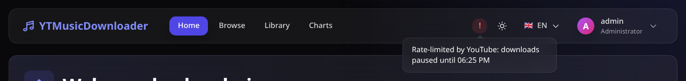

Keeping *Max concurrent downloads* at 1 is the best way to avoid this in the first place.

### Backup and migration

**Admin Panel → Backup** exports a JSON document with any of:

- **Library**: followed artists, standalone albums, playlists (with their songs). On import, the new instance follows them again and downloads their music.
- **Charts**: chart subscriptions.
- **Catalog**: every artist/album/track row with relative file paths. Only useful if you also copy the `data/` folder: the import then recognises files already on disk instead of re-downloading.
- **Users**: accounts, roles and password hashes (keep this file private), with each one's liked artists and dismissed recommendations.
- **Settings**: application settings.

Any user can export the *library* part alone from the Library page (nothing personal in it), which is a handy way to share "here's who I follow" between instances.

Importing first shows a dry-run preview (what would be followed, queued, skipped) and only applies on confirmation. Existing data is never overwritten: missing artists/albums/charts are added and their downloads queued; existing users are left untouched, except that the backup's likes and dismissed recommendations are added to them. Likes of artists that end up outside the library are skipped.

## Running behind a reverse proxy

Proxy to port 8000 and set `COOKIE_SECURE=true` if the proxy terminates TLS (the app doesn't infer it from the proxy). The frontend and API share one origin, so no CORS configuration is required. The `/api/health` endpoint (no auth) can be used for uptime checks; it returns 503 if the database, ffmpeg/ffprobe or the data directories are unhealthy.

**Set `FORWARDED_ALLOW_IPS` to your proxy's address.** Without it the app sees every request as coming from the proxy, so the per-IP sign-in limit is shared by all your users: one person guessing passwords blocks sign-in for everyone. With it, the app takes the real client address from the proxy's `X-Forwarded-For` header (and the scheme from `X-Forwarded-Proto`). `X-Real-IP` and `Forwarded` are not read: Traefik, Caddy and Nginx Proxy Manager send `X-Forwarded-For` by default, plain nginx needs `proxy_set_header X-Forwarded-For $proxy_add_x_forwarded_for;`. With several proxies in a row (e.g. Cloudflare → Traefik), every hop must be trusted.

- Proxy in another container on the same Docker network (Traefik, Caddy, Nginx Proxy Manager…): use the network's subnet, found with `docker network inspect <network>`, e.g. `FORWARDED_ALLOW_IPS=172.18.0.0/16`.
- Proxy installed on the host, reaching the published port: connections arrive from the Docker network's gateway, so the subnet works here too.

Only trust the proxy. The header is trivial to forge, so `*` (or a range that includes your clients) lets anyone pick their own IP and skip the limit. For the same reason, don't keep port 8000 reachable from outside once the proxy is in place: publish it as `127.0.0.1:8000:8000`, or drop `ports:` entirely when the proxy shares the container's network.

## Single sign-on (OIDC)

Let people sign in through your identity provider (Authelia, Authentik, Pocket ID, Keycloak, Zitadel…) with OpenID Connect. Multi-factor authentication, passkeys and password policies then come from the provider. Password sign-in keeps working alongside, unless you turn it off.

It's configured with environment variables only: whoever can change them decides who may sign in as anyone, so that stays with whoever runs the container.

**At your provider**, create a *confidential* client (one with a secret) using the authorization code flow, and register this redirect URI:

```
<PUBLIC_URL>/api/auth/oidc/callback      e.g. https://music.example.com/api/auth/oidc/callback
```

Most providers only accept HTTPS redirect URIs, so this goes with a [reverse proxy](#running-behind-a-reverse-proxy) and `COOKIE_SECURE=true`. PKCE (S256) is always used; client authentication is `client_secret_basic`, or `client_secret_post` if that's all the provider supports.

**Then set:**

| Variable | Default | Description |
|---|---|---|
| `PUBLIC_URL` | – | Address people use to reach the app, e.g. `https://music.example.com`. The redirect URI is built from it. |
| `OIDC_ISSUER_URL` | – | Your provider's issuer, e.g. `https://auth.example.com`. Its settings are discovered from `<issuer>/.well-known/openid-configuration`. |
| `OIDC_CLIENT_ID` | – | Client ID from the provider |
| `OIDC_CLIENT_SECRET` / `OIDC_CLIENT_SECRET_FILE` | – | Client secret, or a file containing it (Docker / Kubernetes secrets) |
| `OIDC_PROVIDER_NAME` | `SSO` | Shown on the login button: "Sign in with *name*" |
| `OIDC_SCOPES` | `openid profile` | Add `groups` (or your provider's equivalent) to use group roles |
| `OIDC_GROUPS_CLAIM` | `groups` | Name of the claim listing the user's groups |
| `OIDC_ADMIN_GROUP` / `OIDC_MEMBER_GROUP` | – | Provider groups mapped to *administrator* / *member*. Setting either hands roles over to the provider (below). |
| `PASSWORD_LOGIN_ENABLED` | `true` | `false` for single sign-on only |

Single sign-on is on when issuer, client ID and secret are all set. The web process refuses to start on a configuration that can't work (partly configured, no `PUBLIC_URL`, password sign-in off without single sign-on…) and logs why. If the provider is unreachable, the app still starts; the button reports the provider as unavailable.

**Accounts.** An account is tied to the provider's identity (issuer + subject), never to a name, so nobody can take over an account by picking its username at the provider. The first sign-in creates the account (see the *New single sign-on accounts* and *Role* settings), named after the provider's username: if that name is taken here, a suffix is added (`admin-2`), the two accounts are never merged. Deactivated accounts can't sign in. Single sign-on accounts have no password here, so *Change password* and *Reset password* don't apply to them.

*New single sign-on accounts* is on by default, which lets in **everyone your provider will sign in** (as *visitors* unless you change the role). That's what you want with a provider holding only people you trust (your own Authelia, Authentik, Pocket ID…). With a provider anyone can join (open self-registration, a big organisation's directory, a public identity provider), turn it off and use provider groups instead: visitors can't download or change anything, but they see the whole library and their searches run against YouTube from your server's IP.

**Roles from provider groups.** With `OIDC_ADMIN_GROUP` and/or `OIDC_MEMBER_GROUP` set, the provider owns the roles of single sign-on accounts: at every sign-in they become *administrator* (in the admin group), *member* (in the member group) or the default role (in neither), and the role can't be edited in the admin panel. Turn *New single sign-on accounts* off to let in group members only: they can still sign in for the first time, while anyone in neither group is refused, existing accounts included (and their other sessions are signed out). Groups are read from the ID token and the userinfo endpoint. A change of groups (or an account disabled at the provider) applies at the next sign-in, at most *Single sign-on session length* (24 h by default) later.

**Single sign-on only** (`PASSWORD_LOGIN_ENABLED=false`): the password form, registration, *Create user* and *Reset password* go away, and no password admin is created on first start. Get your first administrator with one of:

- `OIDC_ADMIN_GROUP` set to a provider group you're in: you're an admin from your first sign-in;
- sign in once, then `docker compose exec ytmusicdownloader python -m backend.cli set-role <your-username> administrator`;
- start with password sign-in on, sign in as the first admin, promote your single sign-on account in **Admin Panel → Users**, then set `PASSWORD_LOGIN_ENABLED=false` and restart.

**Limits.**

- Removing someone at the provider doesn't end their session here: sessions last up to 7 days. Deactivate the account in **Admin Panel → Users** too.
- Signing out signs out of this app only, not of the provider.
- A sign-in that fails sends you back to the login page with a short reason; the exact cause is in `config/logs/web.log`.

## Recovering access

For when nobody can (or should) use the admin panel, a few commands run inside the container. Use the service name from `docker-compose.yml` (`docker exec -it <container> …` works too):

```bash
docker compose exec ytmusicdownloader python -m backend.cli --help
```

| Command | Does |
|---|---|
| `list-users` | Accounts with their role and status |
| `reset-password <user> [--generate]` | New password (typed twice, hidden), or a generated temporary one with `--generate`. Also reactivates the account and signs it out everywhere. |
| `create-user <user> --role <role> [--generate]` | New account |
| `set-role <user> <role>` | `administrator`, `member` or `visitor` |
| `activate <user>` / `deactivate <user>` | Deactivating also signs the account out |
| `deactivate-all [--except <user>]` | Lockdown: deactivate every account and sign everyone out |
| `get-setting [key]` / `set-setting <key> <value>` | Read or change a setting (same checks as the admin panel) |

Passwords are never passed as arguments (they'd end up in your shell history).

With single sign-on, `list-users` shows how each account signs in. If the provider is down, `reset-password` also works on a single sign-on account: it gets a password as a fallback (with password sign-in enabled).

**Forgot the admin password**

```bash
docker compose exec ytmusicdownloader python -m backend.cli reset-password admin
```

**An admin account was hijacked** (or something is misusing one): lock everyone out except you, then take your account back. Deactivated accounts lose their sessions on their very next request.

```bash
docker compose exec ytmusicdownloader python -m backend.cli deactivate-all --except admin
docker compose exec ytmusicdownloader python -m backend.cli reset-password admin
docker compose exec ytmusicdownloader python -m backend.cli set-role admin administrator   # if it was demoted
```

Then reactivate the legitimate accounts from **Admin Panel → Users**, and check settings and other admins.

**Locked out while someone keeps guessing your password** ("Too many failed attempts" for your account): browsers you're already signed in to aren't affected, but a new browser (or yours after a password reset) is. Turn the per-account limit off for a moment (the per-IP limit still applies), sign in, then turn it back on. Once signed in, your browser has its own allowance again.

```bash
docker compose exec ytmusicdownloader python -m backend.cli set-setting auth.login_max_failures_per_account 0
# sign in, then:
docker compose exec ytmusicdownloader python -m backend.cli set-setting auth.login_max_failures_per_account 5
```

## API

Interactive OpenAPI docs are served at `/api/docs`. Authentication is JWT: `POST /api/auth/login` returns a short-lived access token (send as `Authorization: Bearer …`) and sets an httpOnly refresh cookie; `POST /api/auth/refresh` gets a new access token. Single sign-on goes through `GET /api/auth/oidc/login` and back to `/api/auth/oidc/callback`, which opens the same kind of session.

## How it works

Everything runs in a single Docker container managed by supervisord:

| Process | Role |
|---|---|
| `web` | FastAPI backend + the built React frontend, on port 8000 |
| `worker-download-N` | Downloads audio with yt-dlp (N processes, see `DOWNLOAD_WORKERS`) |
| `worker-metadata-N` | Talks to YouTube Music: artist syncs, album imports, chart syncs (3 processes) |
| `worker-lyrics` | Fetches lyrics from LRCLIB |
| `worker-genres` | Looks up genres on MusicBrainz and Deezer |
| `scheduler` | Periodic syncs, retries and clean-ups |

All work goes through a job queue stored in SQLite (`/config/db.sqlite`). Workers are split by job family so that a slow download never blocks metadata imports and vice versa. If a worker dies mid-job, the job is requeued automatically.

Following an artist queues a `sync_artist` job → which queues an `import_album` job per release → which queues a `download_track` job per track → which queues a `download_lyrics` job once the audio is on disk.

Jobs run in order of where they came from, and every job inherits that from the one that queued it: what a user asked for (follow, download, retry) runs first, then routine upkeep (scheduled syncs, lyrics retries), then large batches (charts, backup restore). So a chart's thousands of downloads never hold up an album you just asked for. Within each of these, an artist's albums are imported before the next artist is synced, so artists complete one at a time.

## Logs

- `docker compose logs -f`: everything, interleaved.
- `./config/logs/`: one rotating file per process (`web.log`, `worker-download-0.log`, `worker-metadata-0.log`, `worker-lyrics.log`, `worker-genres.log`, `scheduler.log`), 5 MB × 3 each.

## Troubleshooting

**Downloads fail across the board right after an update to YouTube**: restart the container. yt-dlp is updated from PyPI at every start, to the newest release published at least a day ago (a brand-new release could be a compromised one, and those are usually pulled within hours). So a fix released today is picked up by a restart tomorrow.

**A track fails with an age-restriction error**: upload account cookies (see above). Such tracks are retried once a day, up to 5 attempts; after that they're marked failed, and *Retry missing tracks* on the album page queues them again.

**Everything is paused with a rate-limit banner**: wait it out; it resolves on its own. If it keeps happening, lower *Max concurrent downloads*.

**Permission errors on `./config` or `./data`**: make sure `PUID`/`PGID` match your host user. Files that already existed before a `PUID` change need a one-time `chown`.

**"Too many failed attempts" for everyone**: you're behind a reverse proxy without `FORWARDED_ALLOW_IPS`, so all users share the proxy's IP. See [Running behind a reverse proxy](#running-behind-a-reverse-proxy). To get back in right away, restart the container (the counters live in memory).

**Single sign-on fails**: the login page shows a short reason; the detail is in `config/logs/web.log`. The usual suspects: the redirect URI registered at the provider doesn't exactly match `<PUBLIC_URL>/api/auth/oidc/callback`, `OIDC_ISSUER_URL` differs from the issuer the provider announces, or the container can't reach the provider (use an address reachable from inside the container). Also open the app at `PUBLIC_URL` itself to sign in: starting from another address (a LAN IP, say) loses the sign-in cookie on the way back.

**Login doesn't stick**: if you're on plain HTTP, `COOKIE_SECURE` must be unset or `false`. If you're on HTTPS, set it to `true`.

**I lost `config/secrets.json`**: a new one is generated on start; every user just has to log in again.

## Development

The stack is FastAPI + SQLAlchemy 2 (backend) and React 18 + Vite + Tailwind + TypeScript (frontend).

The backend expects `/config` and `/data` to exist and be writable (paths are fixed in `backend/config.py`), so the simplest workflow is to run the backend in Docker and only iterate on the frontend:

```bash
docker compose up -d            # backend on :8000
cd frontend
npm install
npm run dev                     # Vite dev server, proxies /api to :8000
```

To run the backend natively (Python 3.14, ffmpeg on PATH, `/config` and `/data` writable):

```bash
pip install -r backend/requirements.txt
uvicorn backend.main:app --reload            # API
python -m backend.jobs.worker                # a worker (WORKER_JOB_TYPES to scope it)
python -m backend.scheduler                  # the scheduler
```

The frontend is built into `backend/static/` by the Dockerfile; the API serves it as an SPA with `/api/*` taking precedence.

Translations live in `frontend/src/locales/`; adding a language is a new JSON file plus one line in `frontend/src/config/i18n.ts`.

## Disclaimer

This tool is intended for personal use with content you have the right to download. Downloading from YouTube may violate YouTube's Terms of Service; you are responsible for how you use it. The project is not affiliated with YouTube or Google.

## License

This project is licensed under the [GNU Affero General Public License v3.0](LICENSE) (AGPL-3.0).

In short: you're free to use, modify, self-host and redistribute it, including commercially, but any modified version you distribute *or run as a service for others* must be released under the same license, with its source code available. See the [LICENSE](LICENSE) file for the full terms.
