<div align="center">


# YTMusicDownloader

**Your own music library, filled from YouTube Music and ready for Jellyfin.**

Follow an artist once: every release is downloaded, tagged, given synced lyrics and filed into a clean folder structure, and new ones keep arriving on their own.

[](LICENSE)
[](https://www.docker.com/)
[](https://www.python.org/)
[](https://react.dev/)

[Features](#features) · [Screenshots](#screenshots) · [Quick start](#quick-start) · [Documentation](#documentation) · [Troubleshooting](#troubleshooting)

</div>

<picture>
  <source media="(prefers-color-scheme: dark)" srcset="docs/screenshots/home-dark.png">
  <source media="(prefers-color-scheme: light)" srcset="docs/screenshots/home-light.png">
  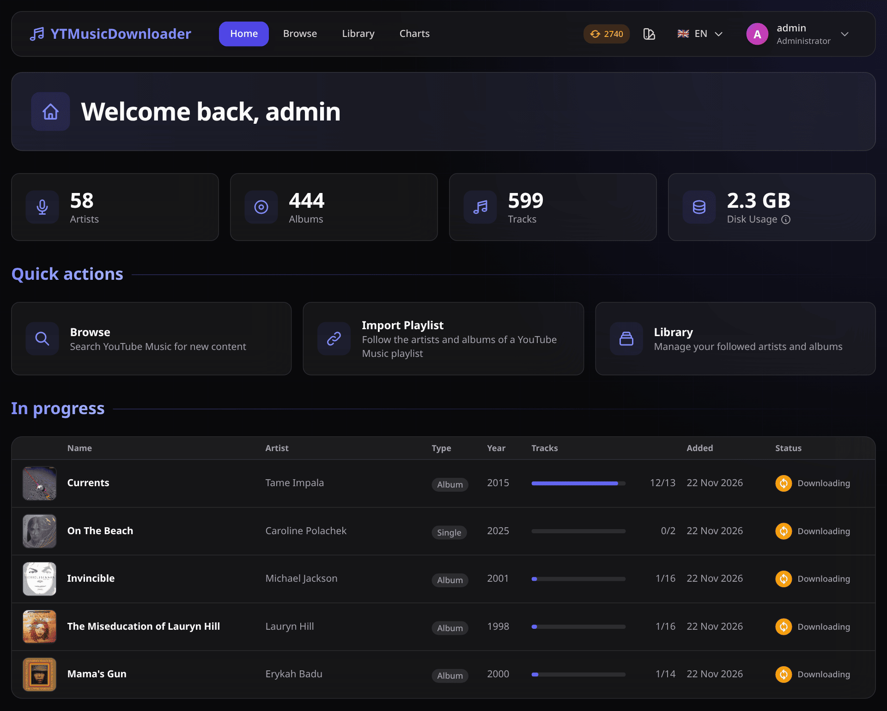
</picture>

## What it is

A self-hosted web app that turns YouTube Music into a music library you own. You pick artists, albums, playlists or whole country charts; it downloads the audio, tags it, finds lyrics and genres, and lays everything out the way Jellyfin (or any media server reading NFO files) expects. Then it keeps watching YouTube Music, so the library stays up to date without you.

It runs as a single Docker container, has a web UI for desktop and phone, and is made for a household or a small group of friends: several users, three roles, optional single sign-on.

## Features

**Build the library**

- **Search YouTube Music** for artists, albums and tracks from the web UI.
- **Follow artists**: every existing release is downloaded, and new ones are picked up automatically.
- **Download single albums** without following the artist.
- **[Playlists](#playlists)**: follow every artist of a YouTube Music playlist or download every album in it, or keep the playlist in the library, followed and/or as an M3U file Jellyfin picks up.
- **[Charts](#charts)**: follow a country's chart and its top N artists (re-synced weekly), optionally unfollowing them once they've been out of it for a few weeks.
- **[Recommendations](#recommendations)**: artists similar to the ones you like, from YouTube Music's own "Fans might also like", personal to each user.
- **Library overview**: download progress for every artist and album, filters (missing lyrics, failed tracks, genre, decade...) and sorting, plus stats with disk usage summed from the real file sizes.

**Lyrics, tags and metadata**

- **[Synced lyrics](#lyrics)** from [LRCLIB](https://lrclib.net), or from YouTube Music itself when LRCLIB has none, saved as `.lrc` files. Missing lyrics are retried daily, plain ones upgraded to synced when they appear, instrumentals recognised. You can also edit them by hand.
- **Best audio, untouched**: the best stream YouTube Music serves, saved as is with no re-encoding (Opus as `.opus`, or AAC as `.m4a` when that ranks higher, for instance with a Premium account's cookies).
- **Full tags**: title, album, artist, album artist, track number, year, genres and embedded cover art.
- **[Genres](#genres)** from [MusicBrainz](https://musicbrainz.org) (specific, community-voted) with [Deezer](https://www.deezer.com) as a fallback. No account or API key needed.
- **[Stays in step with YouTube Music](#keeping-in-step-with-youtube-music)**: added tracks, new titles, reissues, removals and new covers reach the library.

**Media server ready**

- **Jellyfin-friendly layout** with `artist.nfo`, `album.nfo`, `folder.jpg`, `backdrop.jpg` and `cover.jpg`, and genres Jellyfin can browse and mix by.

**For several people**

- **[Multi-user](#users-and-roles)** with three roles (visitor / member / administrator), optional public registration, and httpOnly-cookie sessions.
- **[Single sign-on](#single-sign-on-oidc)** through your identity provider (Authelia, Authentik, Pocket ID, Keycloak...), optional.
- **[Backup and restore](#backup-and-migration)**: export followed artists, albums and charts (or a full backup with users and settings) as JSON, and import it elsewhere after a dry-run preview.

**Gentle on YouTube**

- **[Rate-limit aware](#rate-limiting)**: detects throttling and bot checks, resets its session, and pauses all downloads with exponential backoff instead of hammering YouTube.
- **[Age-restricted tracks](#age-restricted-tracks)** through an optional cookies.txt from a signed-in account, used *only* for those tracks.

**Nice to use**

- Light and dark theme, five accent colours, English and French, a short welcome tour, and a layout that works on a phone (it can be added to the home screen).

## Screenshots

**Browse**: search YouTube Music, or start from artists similar to the ones you like.

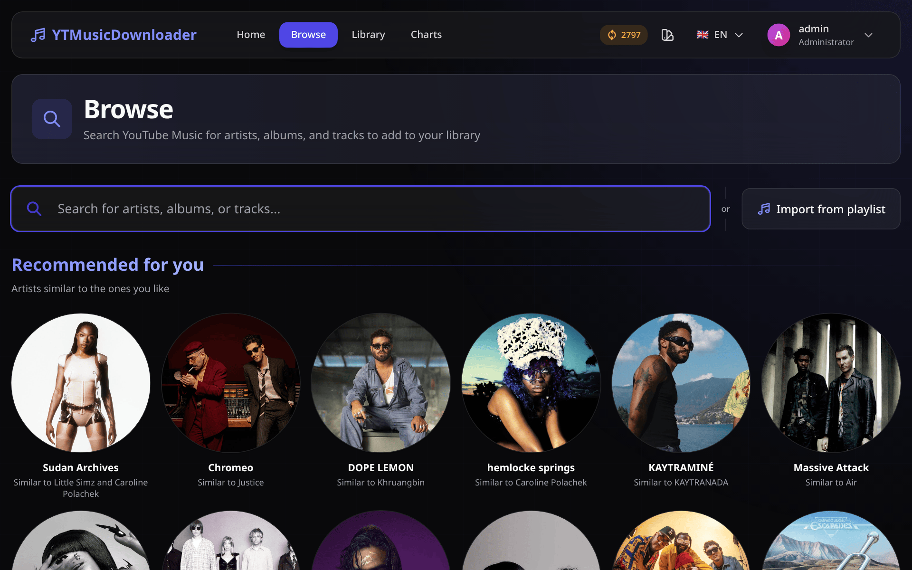

**Artist**: follow once, and every release is tracked, with genres and download status.

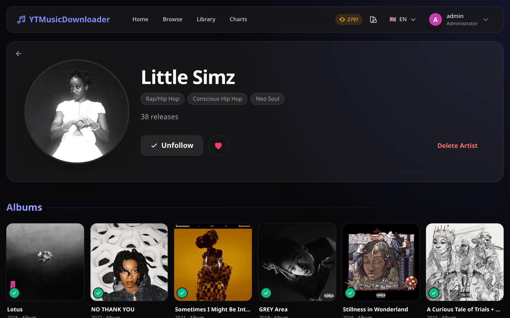

**Album**: every track with its download status and its lyrics badge (synced, plain, instrumental, none).

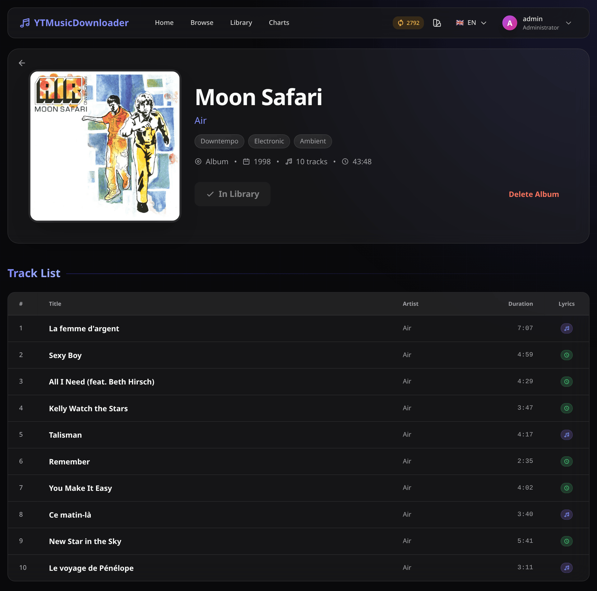

**Library**: every artist and album you follow, with your likes, filters and sorting.

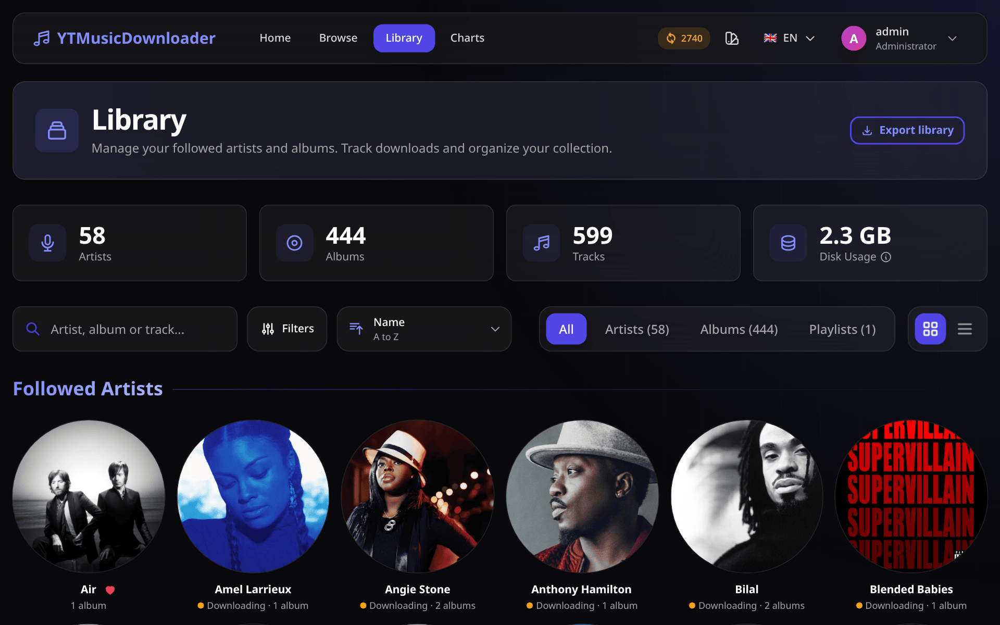

<details>
<summary><b>On a phone</b></summary>
<br>
<p align="center">
  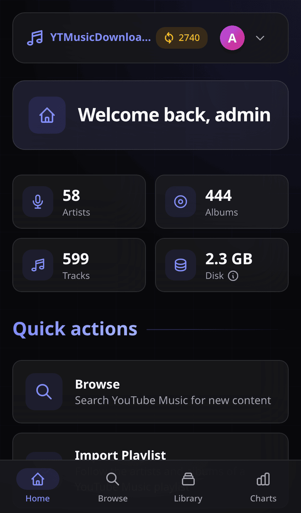
  &nbsp;
  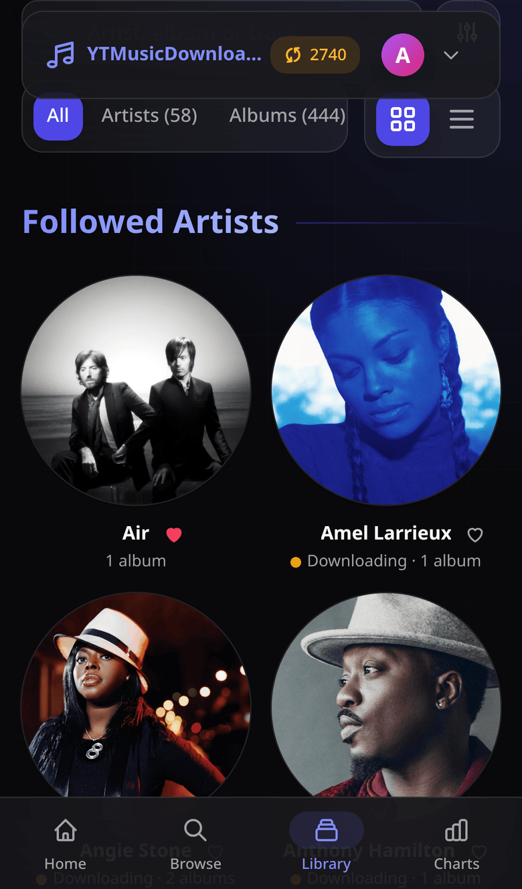
  &nbsp;
  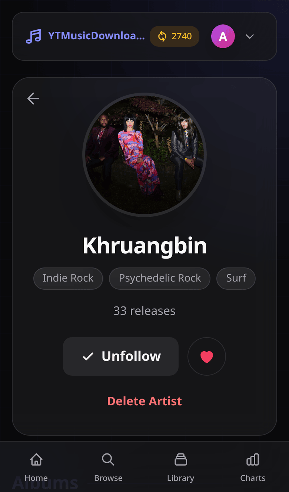
</p>
</details>

More screenshots sit next to the features they show: [playlists](#playlists), [charts](#charts), [lyrics](#lyrics), [admin settings](#admin-settings), [roles and the welcome tour](#users-and-roles), [rate limiting](#rate-limiting).

## Quick start

You need Docker with Compose. In an empty folder, save this as `docker-compose.yml` (set `TZ` to your time zone):

```yaml
services:
  ytmusicdownloader:
    image: ghcr.io/patato0705/ytmusicdownloader:latest
    ports:
      - "8484:8484"
    volumes:
      - ./config:/config
      - ./data:/data
    environment:
      - TZ=Europe/Paris  # your time zone, for the schedules
      # More options: README "Environment variables"
    restart: unless-stopped
```

Then, in a terminal in that folder:

```
docker compose up -d
docker compose logs
```

The log shows the password of the `admin` account the first start creates (the line *Created the first administrator*).

Open <http://localhost:8484> and sign in with it: you'll choose your own right away. Lost it? See [Recovering access](#recovering-access).

**Next steps**

1. Search for an artist on **Browse** and click *Follow*.
2. Point Jellyfin (or any media server reading NFO files) at the `./data` folder.
3. Serving it over HTTPS? Read [Running behind a reverse proxy](#running-behind-a-reverse-proxy).
4. Have an identity provider? Set up [single sign-on](#single-sign-on-oidc).
5. Invite people from **Admin panel → Users**.

---

# Documentation

**Using the app**: [Users and roles](#users-and-roles) · [Following and downloading](#following-and-downloading) · [Kept out of the library](#kept-out-of-the-library) · [Keeping in step with YouTube Music](#keeping-in-step-with-youtube-music) · [Playlists](#playlists) · [Charts](#charts) · [Recommendations](#recommendations) · [Lyrics](#lyrics) · [Genres](#genres)

**Running it**: [Files and folders](#files-and-folders) · [Updating](#updating) · [Environment variables](#environment-variables) · [Admin settings](#admin-settings) · [Schedules](#schedules) · [Reverse proxy](#running-behind-a-reverse-proxy) · [Single sign-on](#single-sign-on-oidc) · [Age-restricted tracks](#age-restricted-tracks) · [Rate limiting](#rate-limiting) · [Backup and migration](#backup-and-migration) · [Recovering access](#recovering-access)

**Under the hood**: [How it works](#how-it-works) · [API](#api) · [Logs](#logs) · [Development](#development)

[Troubleshooting](#troubleshooting) · [Contributing](#contributing) · [Disclaimer](#disclaimer) · [License](#license)

## Using the app

### Users and roles

| Role | Can do |
|---|---|
| **Visitor** | Read-only: browse the library, artists, albums, charts and lyrics. Default for new accounts. |
| **Member** | Everything a visitor can, plus follow/unfollow artists, download albums, edit lyrics, like artists and get recommendations. |
| **Administrator** | Everything a member can, plus delete artists/albums (including files), and manage users, charts, settings and backups. |

Admins create users from **Admin panel → Users**, or turn on public registration in [Settings](#admin-settings).

At their first sign-in, everyone gets a short tour of what their role can do (the lyrics badges, charts, likes and recommendations, playlist import...), starting with the language, theme and accent colour. It's shown once per account, on any device, and closing it at any step ends it for good.

<p align="center">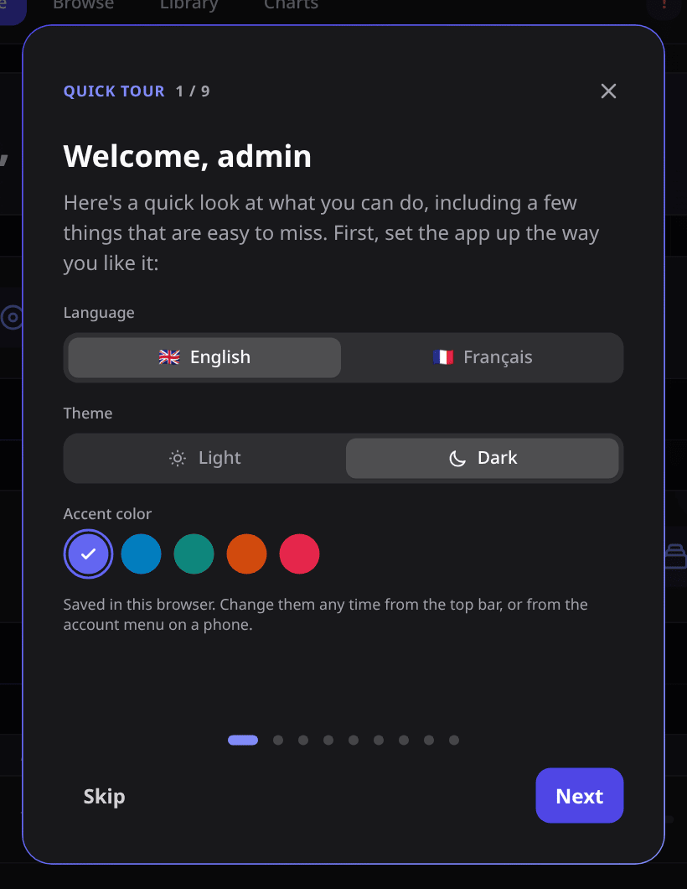</p>

**Passwords**

- Changing your password (user menu → *Change password*) signs you out of every other browser and device; the one you changed it from stays signed in.
- Forgotten password: an admin uses *Reset password* in **Admin panel → Users**, which shows a temporary password once to pass on. The user is signed out everywhere and has to pick a new password before doing anything else (the temporary password works for nothing but that).
- Admins can reset anyone's password, other administrators' included (administrators are trusted), but not their own: use *Change password*, or the [recovery commands](#recovering-access) if you can't sign in.

### Following and downloading

| Action | Where | What happens |
|---|---|---|
| **Follow an artist** | artist page → *Follow* | Downloads every release and keeps watching for new ones. Following also likes the artist. |
| **Unfollow** | artist page | Stops watching for new releases and cancels downloads that haven't started yet (one in progress is allowed to finish). Nothing is deleted: the artist stays in your library in "light" (metadata-only) mode, and charts and artists-mode playlists won't follow it again (see [Kept out of the library](#kept-out-of-the-library)). |
| **Download an album** | album page → *Download album* | Grabs just that album. The artist is added to the library in light mode so the album has somewhere to live. |
| **Retry missing tracks** | album page | Shown on a downloaded album when some tracks failed or have no download queued. Requeues every track that isn't on disk and isn't already waiting. |
| **Delete artist / album** | admin only | Removes the database entries *and* the files on disk. Deleting an album leaves its artist followed: only that album stays out. |

### Kept out of the library

A deleted artist or album, or an unfollowed artist, is **excluded**: nothing automatic brings it back.

- **What leaves it alone**: charts, playlist rescans, artist syncs and backup imports, and the bulk buttons on a playlist page skip it. (A playlist in albums mode can still bring in an unfollowed artist's albums.)
- **What brings it back**: following the artist or downloading the album by hand.
- **Where to see it**: the Library's *Deleted or unfollowed* filter lists everything excluded, each with a restore button. Restoring lets charts, playlists and syncs bring it back again; nothing is downloaded right away.

Exclusions are part of [backups](#backup-and-migration).

<p align="center">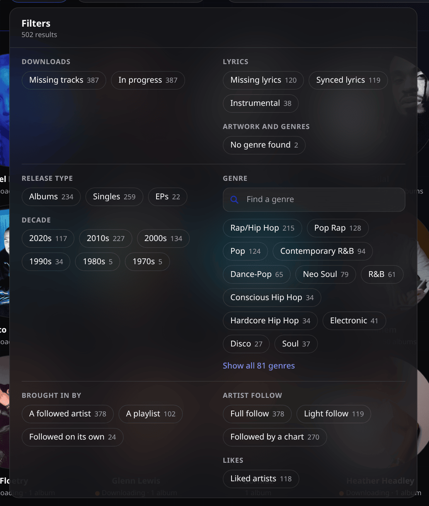</p>

### Keeping in step with YouTube Music

Albums in the library keep following YouTube Music. Every artist sync (followed artists, and light-mode artists with an album in the library) also re-reads that artist's downloaded albums once a month:

- tracks added on YouTube Music are downloaded;
- changed titles, track numbers, album titles and years are written to the files' tags;
- a track YouTube Music no longer lists is marked *Removed* on the album page: its file stays in the library, it's just never downloaded again;
- renamed artists get their files re-tagged at their next sync;
- a cover YouTube Music changed replaces `cover.jpg` and the art embedded in the files (only a changed cover is downloaded).

File and folder names are kept as first written.

<details>
<summary><b>Reissues and albums removed from YouTube Music</b></summary>
<br>

When YouTube Music reissues an album under a new ID (the artist's page drops the old one and lists a new one with the same tracks, even under a new title such as a deluxe edition), the library album moves to the new ID: its files and folder stay, and the refresh above brings its tracklist up to date. Two releases the artist's page lists side by side stay two albums.

An album the page no longer lists, with nothing in its place and whose page no longer opens, is marked *Removed from YouTube Music*: its files stay, nothing more is downloaded for it, and the mark goes if the album comes back.

A reissue reached through a playlist or a download before the next artist sync is recognised the same way, so it never downloads a second copy.
</details>

### Playlists

On the **Browse** page, click *Import from playlist* (next to the search bar) and paste a YouTube Music playlist URL (or a raw playlist ID). The page lists the unique artists and albums in it, with per-item buttons and three bulk actions: *Follow main artists*, *Follow all artists* and *Download all albums*. These act once: later changes to the playlist are ignored.

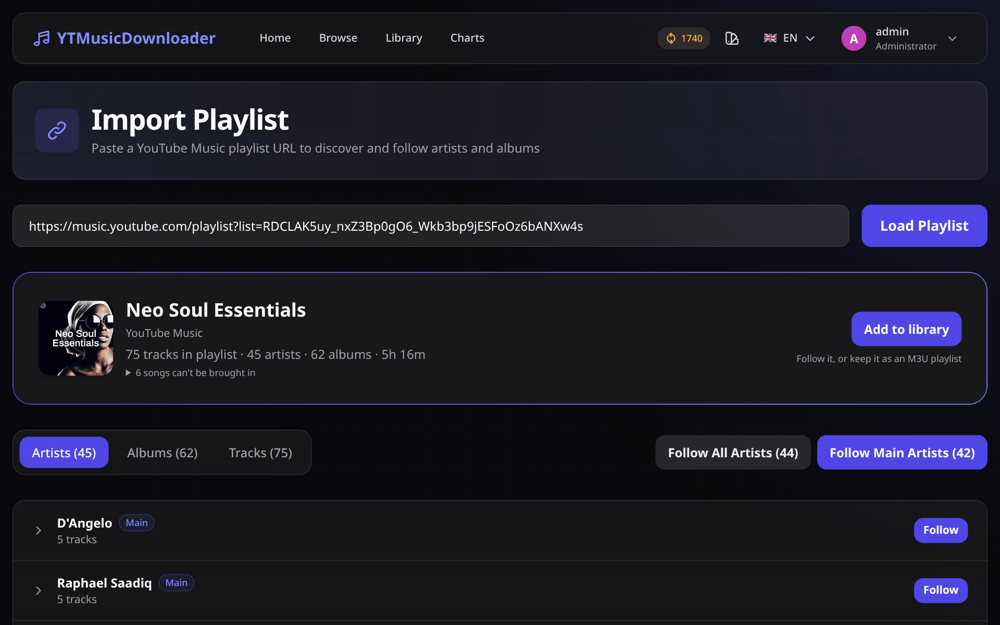

> [!NOTE]
> Only public and unlisted playlists can be read (the app isn't signed in to YouTube), so private playlists and *Liked music* are out of reach. Songs with no album (music videos, uploads) are skipped by every option, so build playlists from songs rather than videos (the page counts the songs it skips).

#### Playlists in the library

*Add to library* (on the playlist page) keeps the playlist in the library, listed under **Library → Playlists**. You choose:

- **What its songs bring in**: their **albums** (each song's whole album is downloaded) or their **artists** (each song's main artist is followed, so all their releases are downloaded).
- **Keep following**: the playlist is rescanned on the *Playlist sync* [schedule](#schedules), and new songs bring in their albums or artists. Off, it's added once and later changes are ignored.
- **M3U file**: the playlist is written to `Playlists/<title>.m3u8` in the music folder, in playlist order, with paths relative to it. Jellyfin imports it as a playlist on its next library scan, and follows its changes. Songs are added to it as they're downloaded; on a followed playlist, a song removed from the playlist leaves the M3U, while its file stays (it belongs to its album).

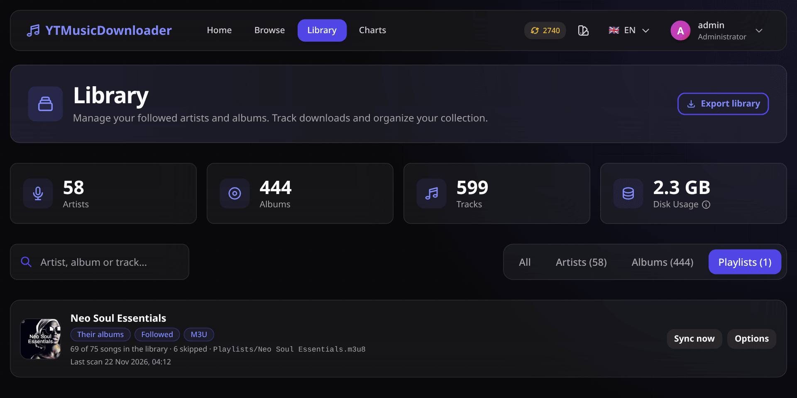

A playlist's song isn't always the very track that's downloaded for it (YouTube Music has several IDs for one song), so each song is looked up by its ID, then by title in its album, then by title and artist anywhere in the library. **Library → Playlists** shows how many songs are found, and how many are skipped.

The options can be changed later:

- Switching from albums to artists follows the main artist of every song in the playlist; switching back keeps those artists followed, and new songs bring in their albums again.
- Unfollowing stops the rescans and keeps the M3U as last written.
- *Remove* deletes the playlist and its M3U, never the music.

A rescan skips [excluded](#kept-out-of-the-library) artists and albums, so deleting something a playlist lists doesn't bring it back. What a playlist brings in when it's added (or switched to artists) runs at low priority, like a chart, so it doesn't hold up what you ask for meanwhile.

### Charts

Admins follow a country chart from **Admin panel → Charts** and choose how many of its top artists to follow (1 to 40). Those artists are followed in full. The chart is re-synced on the *Chart sync* [schedule](#schedules), following any new entrants. The **Charts** page shows the current chart for every followed country.

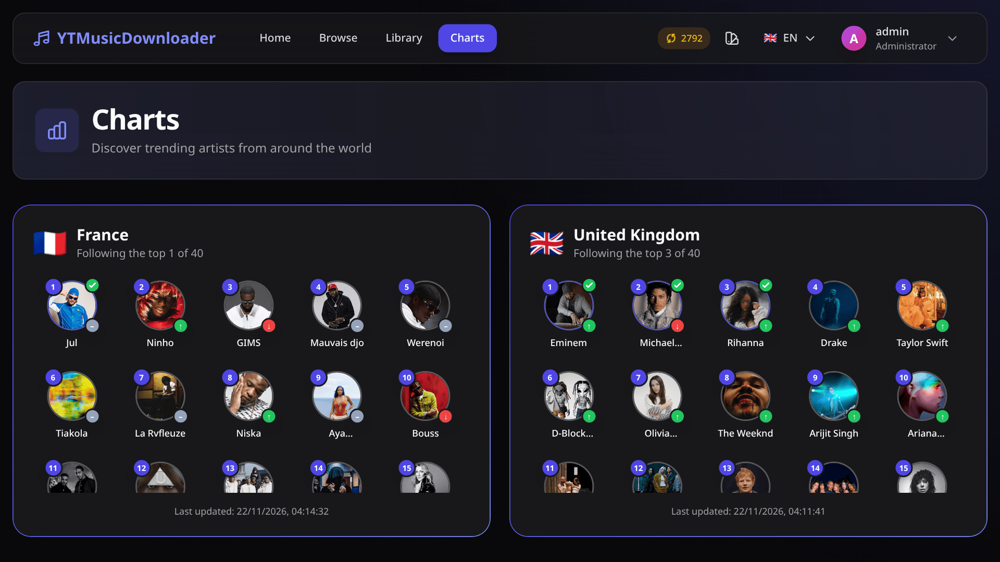

**Unfollow after** (in the follow dialog and in **Admin panel → Charts**; *Never* by default): an artist a chart followed is unfollowed, like the Unfollow button (files stay, new releases stop), once it has been out of that chart, and of every other followed chart, for that many weeks.

- It's kept if anyone likes it, if a followed playlist in artists mode lists it, or while a chart that listed it is disabled.
- Only successful syncs count, so a YouTube Music outage never unfollows anyone, and an artist that comes back into the chart is followed again.
- Artists you followed yourself are never touched, and unfollowing a chart leaves its artists followed.

The artist page says when an artist was followed by a chart, and the Library's *Artist follow* filter lists them.

### Recommendations

With the search box empty, the **Browse** page shows *Recommended for you*: artists similar to the ones you like, with how many of yours each one is similar to ("Similar to 5 artists you like", their names on hover).

- **Where they come from**: YouTube Music's own similar artists ("Fans might also like" on an artist's page), which every artist sync already receives. No extra request, no third party, and they refresh with the syncs.
- **Ranking**: the more of your artists list one, the higher it comes; ties go to the one YouTube Music lists earlier.
- **Personal**: they come from the artists *you* like, not from everything the library follows (charts and playlists bring in artists nobody picked). Artists you like and artists followed in full are left out.

**Liking an artist**: click the *♥* on its card in the **Library**, next to its name in list view (on hover; liked ones always show it), or at the top right of its page. Following an artist likes it too. A like changes nothing in the library: it's only yours. Visitors can't like artists, so they get no recommendations.

**Dismissing**: the *✕* on a card hides the artist from your recommendations (undo from the notice that follows), not from anyone else's. It's listed under your *Dismissed (n)*, where you can restore it; following a dismissed artist restores it too.

### Lyrics

After a track is downloaded, a `download_lyrics` job looks up its lyrics and saves them as `<track>.lrc` next to the audio file.

1. **LRCLIB is asked first** (exact lookup, then fuzzy search with duration matching), and its answer wins: synced lyrics, else plain lyrics (unless *Synced lyrics only* is on), else its word that the track is instrumental (marked as such and not retried).
2. **YouTube Music is asked only when LRCLIB has nothing usable**, for that very track's lyrics (licensed from LyricFind, Musixmatch...). This keeps requests to YouTube down.

When one source can't be reached and the other has nothing, the lookup is retried an hour later instead of the next day. Missing lyrics are retried on the *Lyrics retry* [schedule](#schedules), and the daily upgrade of plain lyrics to synced asks YouTube Music only for songs LRCLIB has no record of.

Each track has a lyrics badge (synced / plain / instrumental / none): click it to view, paste or edit lyrics by hand. Clearing the text deletes the `.lrc` and lets the next retry sweep look them up again.

<p align="center">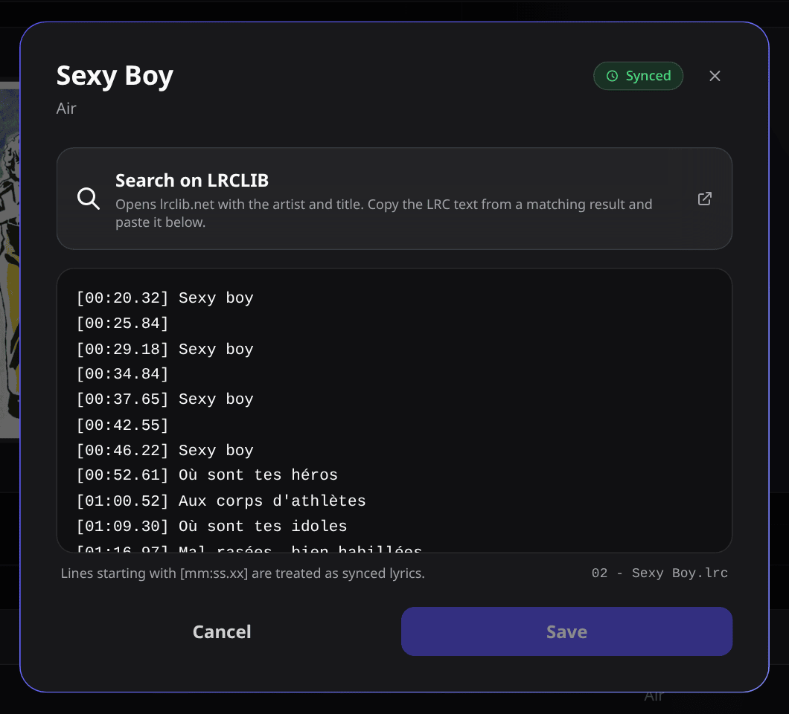</p>

### Genres

YouTube Music has no genres, so they're looked up elsewhere, per artist, on their own worker (`worker-genres`): once when an artist or album is added, then monthly. Each album gets up to three genres, from the first of these that has any:

1. its own genres on MusicBrainz;
2. the artist's genres on MusicBrainz;
3. its genre on Deezer (one per album, broader: *Rap/Hip Hop*, *Dance*);
4. the artist's most common genre on Deezer.

Genres are written into each track's tags and into `album.nfo` / `artist.nfo`, and shown on album and artist pages. The two sources are never mixed, so Jellyfin doesn't end up with two names for the same music.

Artists are looked up by name and only accepted when they share at least one album title with ours, which rules out namesakes. MusicBrainz allows one request per second, so a first lookup takes about 4 seconds per artist: a 200-artist library is done in a quarter of an hour.

<details>
<summary><b>Why MusicBrainz's <i>Hip Hop</i> becomes <i>Rap/Hip Hop</i></b></summary>
<br>

MusicBrainz's *Hip Hop* is renamed to Deezer's *Rap/Hip Hop*. That's a deliberate choice: MusicBrainz has no plain *rap* genre (it files rap under hip hop), so without it no album would ever be tagged Rap, and in practice what MusicBrainz calls hip hop is nearly always rap. Sub-genres such as *Pop Rap* or *Conscious Hip Hop* are kept as they are.
</details>

## Running it

### Files and folders

| Host path | Container path | Contents |
|---|---|---|
| `./config` | `/config` | SQLite database, copies of it from before the last upgrades (`db-backups/`), `secrets.json` (JWT secret), logs, caches, temp downloads, YouTube cookie jars, artwork for artists and albums that aren't downloaded (`covers/`) |
| `./data` | `/data` | Your music library |

Both are created on first start if missing.

> [!IMPORTANT]
> Back up `./config` together with `./data`. Losing `secrets.json` logs everyone out. Losing the database loses the library index (though the *Backup* tab in the admin panel gives you a [portable alternative](#backup-and-migration)).

**File ownership**: the app runs as `PUID:PGID` inside the container (default `1000:1000`), so files it writes to `./config` and `./data` are owned by that user on the host. If `id -u` / `id -g` on your host give different numbers, set them in `docker-compose.yml`. `./config` itself is made readable by that user only (`700`) at every start, since it holds password hashes and the logs: back it up as that user or as root.

**Library layout**: files are written to `/data` (bind-mounted from `./data` by default). Names are sanitised for the filesystem. Point Jellyfin (or any media server that reads NFO files and folder art) at this directory.

```
data/
├── Artist Name/
│   ├── artist.nfo
│   ├── folder.jpg
│   ├── backdrop.jpg
│   └── Album Title/
│       ├── album.nfo
│       ├── cover.jpg
│       ├── 01 - Track Title.opus
│       ├── 01 - Track Title.lrc
│       ├── 02 - Track Title.opus
│       └── ...
└── Playlists/
    └── Playlist Title.m3u8      (only for playlists with an M3U file)
```

### Updating

```bash
docker compose pull
docker compose up -d
```

What changed in each version is on the [releases page](https://github.com/patato0705/YTMusicDownloader/releases). `docker-compose.yml` follows `latest`, the newest release. To choose when to move on instead, put a version in its `image:` line: `:0.7` gets that version's fixes but never 0.8, `:0.7.0` stays exactly there. Versions before 1.0 may change something you have to act on from one minor version to the next (0.7 to 0.8): its release notes say so.

On start, the app upgrades its database to the new version's schema by itself. Before changing anything, it copies the database to `config/db-backups/` (the copies from the last three upgrades are kept). An upgrade that fails changes nothing: the app stops with the reason in the log and the database is left as it was.

<details>
<summary><b>Going back to an older version</b></summary>
<br>

An older version can't read a database a newer one has upgraded, so restore the copy taken before the upgrade:

1. Stop the container.
2. Delete `config/db.sqlite-wal` and `config/db.sqlite-shm` if they exist: they belong to the upgraded database, and SQLite would apply them to the copy.
3. Put the copy taken before the upgrade back as `config/db.sqlite`.
4. Put that version in the `image:` line of `docker-compose.yml` (`ghcr.io/patato0705/ytmusicdownloader:0.7.0`, say) and start it.
</details>

### Environment variables

Set in `docker-compose.yml`. All are optional.

| Variable | Default | Description |
|---|---|---|
| `TZ` | `Europe/Paris` | Timezone for log timestamps and [fixed-time schedules](#schedules) |
| `PUID` / `PGID` | `1000` / `1000` | User/group the app runs as (see [Files and folders](#files-and-folders)) |
| `COOKIE_SECURE` | `false` | Set to `true` when served over HTTPS (behind a TLS-terminating reverse proxy). Leave off for plain HTTP or login won't persist. |
| `FORWARDED_ALLOW_IPS` | `127.0.0.1` | Address(es) or subnet(s) of your reverse proxy, comma-separated. Required behind a proxy, see [Running behind a reverse proxy](#running-behind-a-reverse-proxy). |
| `DOWNLOAD_WORKERS` | `3` | Number of download worker *processes*. This is a ceiling; how many actually run at once is the *Max concurrent downloads* setting in the admin panel. |
| `YTDLP_AUTO_UPDATE` | `true` | yt-dlp is updated at every start (to releases at least a day old). Set to `false` to keep the version the image was built with. |
| `CORS_ALLOWED_ORIGINS` | *(empty)* | Comma-separated origins, only needed if you serve the frontend from a different origin than the API. Leave unset for the standard setup. |
| `PUBLIC_URL`, `OIDC_*`, `PASSWORD_LOGIN_ENABLED` | – | Single sign-on, see [Single sign-on (OIDC)](#single-sign-on-oidc) |
| `LOG_LOCAL_TIME` | `1` | Set to `0` for UTC log timestamps |

### Admin settings

Everything below is changed live from **Admin panel → Settings**, no restart needed.

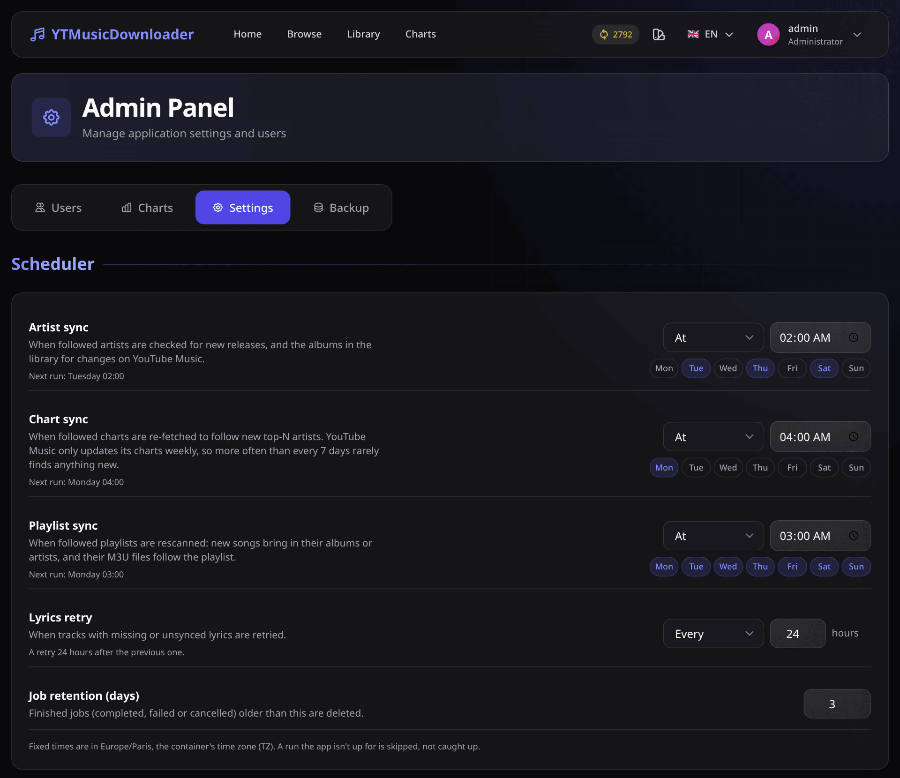

**Scheduler** (see [Schedules](#schedules))

| Setting | Default | Description |
|---|---|---|
| Artist sync | Tue, Thu, Sat at 02:00 | When followed artists are checked for new releases, and the albums in the library for changes |
| Chart sync | Mondays at 04:00 | When followed charts are re-fetched (YouTube Music updates its charts weekly) |
| Playlist sync | every day at 03:00 | When followed playlists are rescanned for new songs |
| Lyrics retry | every 24 h | When tracks with missing or plain lyrics are retried |
| Job retention | 3 days | Finished jobs (completed, failed or cancelled) older than this are deleted |

**Authentication**

| Setting | Default | Description |
|---|---|---|
| Public registration | off | Let anyone create an account (new accounts are *visitors*) |
| Failed sign-ins per IP | 10 | Wrong passwords allowed from one IP within the window before it's blocked. An IPv6 address counts by its /64 network, what a single connection is given. 0 turns this check off. |
| Failed sign-ins per account | 5 | Wrong passwords allowed for one account within the window before *new* browsers are blocked from it. Browsers signed in to the account before (and not signed out since) get their own allowance, so hammering `admin` from elsewhere doesn't lock you out of your usual browser. Also applies to wrong current passwords on *Change password*. 0 turns this check off. |
| Failed sign-in window | 15 min | How long failed sign-ins are remembered; blocks lift as they expire |
| New single sign-on accounts | on | Create an account at someone's first single sign-on. When off, only existing accounts get in; with provider groups configured, only members of those groups (an existing account that has left them is refused too). |
| Role of new single sign-on accounts | visitor | *Visitor* or *member* |
| Single sign-on session length | 24 h | How long a single sign-on session lasts before going through the provider again (usually one click). Role changes and deactivations at the provider only apply from then, hence shorter than password sessions (7 days). |

The three single sign-on settings are shown only when [single sign-on](#single-sign-on-oidc) is configured.

**Downloads**

| Setting | Default | Description |
|---|---|---|
| Max concurrent downloads | 1 | Parallel YouTube downloads. Capped by `DOWNLOAD_WORKERS`. Every extra stream from one IP raises the odds of being rate-limited. |
| Rate-limit pause | 10 min | How long all downloads stop after a rate limit. Doubles on each consecutive pause (up to 16×) until a download succeeds. |
| YouTube account cookies | none | See [Age-restricted tracks](#age-restricted-tracks) |

**Features**

| Setting | Default | Description |
|---|---|---|
| Lyrics download | on | Fetch lyrics for every downloaded track, from LRCLIB, or YouTube Music when LRCLIB has none |
| Synced lyrics only | on | Reject plain lyrics; keep retrying for synced ones |
| Genre lookup | on | Look up genres on MusicBrainz and Deezer. Off stops the lookups; genres already found stay in the files. |
| Charts | on | Enable the Charts page and chart subscriptions |

**YouTube Music**

| Setting | Default | Description |
|---|---|---|
| YouTube Music language | `en` | Language of fetched metadata (bios, descriptions) |

### Schedules

Artist syncs, chart syncs, playlist syncs and lyrics retries each run on their own schedule, set in **Admin panel → Settings → Scheduler**:

- **Every N hours** (days for charts): each artist or chart is synced N hours after its own last sync, so the work spreads over the day.
- **At a fixed time**, on the days of the week you tick: say 04:00 every day, or 07:00 on Mondays and Fridays. Everything due is queued at that time. The settings page shows the next run.

Fixed times are in the container's time zone (`TZ` in `docker-compose.yml`). A fixed run the app wasn't up for (more than 30 minutes late) is skipped rather than caught up, so a sync meant for a quiet hour doesn't land in a busy one. Following an artist or a chart still syncs it right away; the schedule only drives the repeats. Genre lookups go along with the artist syncs.

### Running behind a reverse proxy

Proxy to port 8484 and set `COOKIE_SECURE=true` if the proxy terminates TLS (the app doesn't infer it from the proxy). The frontend and API share one origin, so no CORS configuration is required. The `/api/health` endpoint (no auth) can be used for uptime checks; it returns 503 if the database, ffmpeg/ffprobe or the data directories are unhealthy. Being public, it only says which check fails: the reason is in the log (`docker compose logs`, "Health check failing").

> [!WARNING]
> **Set `FORWARDED_ALLOW_IPS` to your proxy's address.** Without it the app sees every request as coming from the proxy, so the per-IP sign-in limit is shared by all your users: one person guessing passwords blocks sign-in for everyone.

With it, the app takes the real client address from the proxy's `X-Forwarded-For` header (and the scheme from `X-Forwarded-Proto`). `X-Real-IP` and `Forwarded` are not read: Traefik, Caddy and Nginx Proxy Manager send `X-Forwarded-For` by default, plain nginx needs `proxy_set_header X-Forwarded-For $proxy_add_x_forwarded_for;`. With several proxies in a row (e.g. Cloudflare → Traefik), every hop must be trusted.

- **Proxy in another container on the same Docker network** (Traefik, Caddy, Nginx Proxy Manager...): use the network's subnet, found with `docker network inspect <network>`, e.g. `FORWARDED_ALLOW_IPS=172.18.0.0/16`.
- **Proxy installed on the host**, reaching the published port: connections arrive from the Docker network's gateway, so the subnet works here too.

Only trust the proxy. The header is trivial to forge, so `*` (or a range that includes your clients) lets anyone pick their own IP and skip the limit. For the same reason, don't keep port 8484 reachable from outside once the proxy is in place: publish it as `127.0.0.1:8484:8484`, or drop `ports:` entirely when the proxy shares the container's network.

### Single sign-on (OIDC)

Let people sign in through your identity provider (Authelia, Authentik, Pocket ID, Keycloak, Zitadel...) with OpenID Connect. Multi-factor authentication, passkeys and password policies then come from the provider. Password sign-in keeps working alongside, unless you turn it off.

It's configured with environment variables only: whoever can change them decides who may sign in as anyone, so that stays with whoever runs the container.

**1. At your provider**, create a *confidential* client (one with a secret) using the authorization code flow, and register this redirect URI:

```
<PUBLIC_URL>/api/auth/oidc/callback      e.g. https://music.example.com/api/auth/oidc/callback
```

Most providers only accept HTTPS redirect URIs, so this goes with a [reverse proxy](#running-behind-a-reverse-proxy) and `COOKIE_SECURE=true`. PKCE (S256) is always used; client authentication is `client_secret_basic`, or `client_secret_post` if that's all the provider supports.

**2. Then set:**

| Variable | Default | Description |
|---|---|---|
| `PUBLIC_URL` | – | Address people use to reach the app, e.g. `https://music.example.com`. The redirect URI is built from it. |
| `OIDC_ISSUER_URL` | – | Your provider's issuer, e.g. `https://auth.example.com`. Its settings are discovered from `<issuer>/.well-known/openid-configuration`. |
| `OIDC_CLIENT_ID` | – | Client ID from the provider |
| `OIDC_CLIENT_SECRET` / `OIDC_CLIENT_SECRET_FILE` | – | Client secret, or a file containing it (Docker / Kubernetes secrets) |
| `OIDC_PROVIDER_NAME` | `SSO` | Shown on the login button: "Sign in with *name*" |
| `OIDC_SCOPES` | `openid profile` | Add `groups` (or your provider's equivalent) to use group roles |
| `OIDC_GROUPS_CLAIM` | `groups` | Name of the claim listing the user's groups |
| `OIDC_ADMIN_GROUP` / `OIDC_MEMBER_GROUP` | – | Provider groups mapped to *administrator* / *member*. Setting either hands roles over to the provider (below). |
| `PASSWORD_LOGIN_ENABLED` | `true` | `false` for single sign-on only |

For example, in `docker-compose.yml`:

```yaml
    environment:
      - TZ=Europe/Paris
      - COOKIE_SECURE=true
      - PUBLIC_URL=https://music.example.com
      - OIDC_ISSUER_URL=https://auth.example.com
      - OIDC_CLIENT_ID=ytmusicdownloader
      - OIDC_CLIENT_SECRET_FILE=/run/secrets/oidc_client_secret
      - OIDC_PROVIDER_NAME=Authelia
      # Optional: roles from provider groups
      - OIDC_SCOPES=openid profile groups
      - OIDC_ADMIN_GROUP=ytmd-admins
      - OIDC_MEMBER_GROUP=ytmd-members
```

Single sign-on is on when issuer, client ID and secret are all set. The web process refuses to start on a configuration that can't work (partly configured, no `PUBLIC_URL`, password sign-in off without single sign-on...) and logs why. If the provider is unreachable, the app still starts; the button reports the provider as unavailable.

#### Accounts

An account is tied to the provider's identity (issuer + subject), never to a name, so nobody can take over an account by picking its username at the provider.

- The first sign-in creates the account (see the *New single sign-on accounts* and *Role* [settings](#admin-settings)), named after the provider's username. If that name is taken here, a suffix is added (`admin-2`): the two accounts are never merged.
- Deactivated accounts can't sign in.
- Single sign-on accounts have no password here, so *Change password* and *Reset password* don't apply to them.

> [!WARNING]
> *New single sign-on accounts* is on by default, which lets in **everyone your provider will sign in** (as *visitors* unless you change the role). That's what you want with a provider holding only people you trust (your own Authelia, Authentik, Pocket ID...). With a provider anyone can join (open self-registration, a big organisation's directory, a public identity provider), turn it off and use provider groups instead: visitors can't download or change anything, but they see the whole library and their searches run against YouTube from your server's IP.

#### Roles from provider groups

With `OIDC_ADMIN_GROUP` and/or `OIDC_MEMBER_GROUP` set, the provider owns the roles of single sign-on accounts. At every sign-in they become *administrator* (in the admin group), *member* (in the member group) or the default role (in neither), and the role can't be edited in the admin panel.

Turn *New single sign-on accounts* off to let in group members only: they can still sign in for the first time, while anyone in neither group is refused, existing accounts included (and their other sessions are signed out).

Groups are read from the ID token and the userinfo endpoint. A change of groups (or an account disabled at the provider) applies at the next sign-in, at most *Single sign-on session length* (24 h by default) later.

#### Single sign-on only

With `PASSWORD_LOGIN_ENABLED=false`, the password form, registration, *Create user* and *Reset password* go away, and no password admin is created on first start. Get your first administrator with one of:

- `OIDC_ADMIN_GROUP` set to a provider group you're in: you're an admin from your first sign-in;
- sign in once, then `docker compose exec ytmusicdownloader python -m backend.cli set-role <your-username> administrator`;
- start with password sign-in on, sign in as the first admin, promote your single sign-on account in **Admin panel → Users**, then set `PASSWORD_LOGIN_ENABLED=false` and restart.

#### Limits

- Removing someone at the provider doesn't end their session here: sessions last up to 7 days. Deactivate the account in **Admin panel → Users** too.
- Signing out signs out of this app only, not of the provider.
- A sign-in that fails sends you back to the login page with a short reason; the exact cause is in `config/logs/web.log`.

### Age-restricted tracks

Age-restricted videos need a signed-in, age-verified YouTube account. Export a `cookies.txt` (Netscape format; browser extensions such as *Get cookies.txt LOCALLY* do this) while on youtube.com, and upload it under **Admin panel → Settings → YouTube account cookies**.

The jar is used **only** as a fallback for tracks that fail with an age-gate error (never for ordinary downloads, and never to get around a rate limit), so the account sees a handful of requests at most.

> [!CAUTION]
> Still, use a throwaway account, not your main one.

### Rate limiting

Downloads use an anonymous session. When YouTube throttles it ("rate-limited", "confirm you're not a bot", HTTP 429...):

1. the worker discards its cookie jar and retries once with a fresh session;
2. if that still fails, *all* downloads pause (10 min by default, doubling on each consecutive strike), and a red *!* in the navbar gives the resume time (hover or tap it);
3. the affected tracks go back to *queued*, not *failed*;
4. once a download succeeds, the escalation resets.

<p align="center">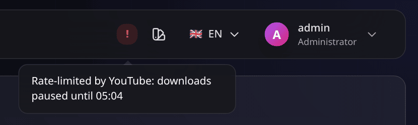</p>

> [!TIP]
> Keeping *Max concurrent downloads* at 1 is the best way to avoid this in the first place.

### Backup and migration

**Admin panel → Backup** exports a JSON document with any of:

- **Library**: followed artists, standalone albums, playlists (with their songs), and what's excluded. On import, the new instance follows them again and downloads their music, leaving out whatever is excluded (in the file or on the new instance).
- **Charts**: chart subscriptions.
- **Catalog**: every artist/album/track row with relative file paths. Only useful if you also copy the `data/` folder: the import then recognises files already on disk instead of re-downloading.
- **Users**: accounts, roles and password hashes (keep this file private), with each one's liked artists and dismissed recommendations.
- **Settings**: application settings.

Any user can export the *library* part alone from the Library page (nothing personal in it), which is a handy way to share "here's who I follow" between instances.

Importing first shows a dry-run preview (what would be followed, queued, skipped) and only applies on confirmation. Existing data is never overwritten: missing artists/albums/charts are added and their downloads queued; existing users are left untouched, except that the backup's likes and dismissed recommendations are added to them. Likes of artists that end up outside the library are skipped.

### Recovering access

For when nobody can (or should) use the admin panel, a few commands run inside the container. Use the service name from `docker-compose.yml` (`docker exec -it <container> ...` works too):

```bash
docker compose exec ytmusicdownloader python -m backend.cli --help
```

| Command | Does |
|---|---|
| `list-users` | Accounts with their role and status |
| `reset-password <user> [--generate]` | New password (typed twice, hidden), or a generated temporary one with `--generate`. Also reactivates the account and signs it out everywhere. |
| `create-user <user> --role <role> [--generate]` | New account |
| `set-role <user> <role>` | `administrator`, `member` or `visitor` |
| `activate <user>` / `deactivate <user>` | Deactivating also signs the account out |
| `deactivate-all [--except <user>]` | Lockdown: deactivate every account and sign everyone out |
| `get-setting [key]` / `set-setting <key> <value>` | Read or change a setting (same checks as the admin panel) |

Passwords are never passed as arguments (they'd end up in your shell history).

With single sign-on, `list-users` shows how each account signs in. If the provider is down, `reset-password` also works on a single sign-on account: it gets a password as a fallback (with password sign-in enabled).

**Forgot the admin password**

```bash
docker compose exec ytmusicdownloader python -m backend.cli reset-password admin
```

<details>
<summary><b>An admin account was hijacked</b> (or something is misusing one)</summary>
<br>

Lock everyone out except you, then take your account back. Deactivated accounts lose their sessions on their very next request.

```bash
docker compose exec ytmusicdownloader python -m backend.cli deactivate-all --except admin
docker compose exec ytmusicdownloader python -m backend.cli reset-password admin
docker compose exec ytmusicdownloader python -m backend.cli set-role admin administrator   # if it was demoted
```

Then reactivate the legitimate accounts from **Admin panel → Users**, and check settings and other admins.
</details>

<details>
<summary><b>Locked out while someone keeps guessing your password</b></summary>
<br>

"Too many failed attempts" for your account: browsers you're already signed in to aren't affected, but a new browser (or yours after a password reset) is. Turn the per-account limit off for a moment (the per-IP limit still applies), sign in, then turn it back on. Once signed in, your browser has its own allowance again.

```bash
docker compose exec ytmusicdownloader python -m backend.cli set-setting auth.login_max_failures_per_account 0
# sign in, then:
docker compose exec ytmusicdownloader python -m backend.cli set-setting auth.login_max_failures_per_account 5
```
</details>

## Under the hood

### How it works

Everything runs in a single Docker container managed by supervisord:

| Process | Role |
|---|---|
| `web` | FastAPI backend + the built React frontend, on port 8484 |
| `worker-download-N` | Downloads audio with yt-dlp (N processes, see `DOWNLOAD_WORKERS`) |
| `worker-metadata-N` | Talks to YouTube Music: artist syncs, album imports, chart syncs (3 processes) |
| `worker-lyrics` | Fetches lyrics from LRCLIB and YouTube Music |
| `worker-genres` | Looks up genres on MusicBrainz and Deezer |
| `scheduler` | Periodic syncs, retries and clean-ups |

All work goes through a job queue stored in SQLite (`/config/db.sqlite`). Workers are split by job family so that a slow download never blocks metadata imports and vice versa. If a worker dies mid-job, the job is requeued automatically.

Following an artist sets off a chain of jobs:

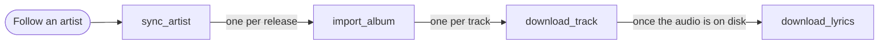

Jobs run in order of where they came from, and every job inherits that from the one that queued it:

1. what a user asked for (follow, download, retry);
2. routine upkeep (scheduled syncs, lyrics retries);
3. large batches (charts, backup restore).

So a chart's thousands of downloads never hold up an album you just asked for. Within each of these, an artist's albums are imported before the next artist is synced, so artists complete one at a time.

### API

Interactive OpenAPI docs are served at `/api/docs`. Authentication is JWT: `POST /api/auth/login` returns a short-lived access token (send as `Authorization: Bearer ...`) and sets an httpOnly refresh cookie; `POST /api/auth/refresh` gets a new access token. Single sign-on goes through `GET /api/auth/oidc/login` and back to `/api/auth/oidc/callback`, which opens the same kind of session.

### Logs

- `docker compose logs -f`: everything, interleaved.
- `./config/logs/`: one rotating file per process (`web.log`, `worker-download-0.log`, `worker-metadata-0.log`, `worker-lyrics.log`, `worker-genres.log`, `scheduler.log`), 5 MB × 3 each.

### Development

The stack is FastAPI + SQLAlchemy 2 (backend) and React 18 + Vite + Tailwind + TypeScript (frontend).

The backend expects `/config` and `/data` to exist and be writable (paths are fixed in `backend/config.py`), so the simplest workflow is to run the backend in Docker and only iterate on the frontend. From a clone of the repository, `docker-compose.dev.yml` builds the image from your checkout (named `ytmusicdownloader:dev`) instead of pulling the published one:

```bash
git clone https://github.com/patato0705/YTMusicDownloader.git
cd YTMusicDownloader
docker compose -f docker-compose.yml -f docker-compose.dev.yml up -d --build   # backend on :8484
cd frontend
npm install
npm run dev                     # Vite dev server, proxies /api to :8484
```

To run the backend natively (Python 3.14, ffmpeg on PATH, `/config` and `/data` writable):

```bash
pip install -r backend/requirements.txt
uvicorn backend.main:app --reload            # API
python -m backend.jobs.worker                # a worker (WORKER_JOB_TYPES to scope it)
python -m backend.scheduler                  # the scheduler
```

The frontend is built into `backend/static/` by the Dockerfile; the API serves it as an SPA with `/api/*` taking precedence.

**Database schema changes**: the schema is managed with [Alembic](https://alembic.sqlalchemy.org). Every change to `backend/models.py` needs a migration script in `backend/migrations/versions/`, which the app applies at startup. To generate one after changing the models (from the repository root, with the development image built by the command above):

```bash
docker run --rm --user "$(id -u):$(id -g)" -v "$PWD/backend:/app/backend" \
  --entrypoint python ytmusicdownloader:dev \
  -m backend.migrations.dev revision "add a rating to tracks"
```

Read the generated script before committing it: `backend/migrations/dev.py` lists what autogenerate gets wrong (a new NOT NULL column needs a `server_default`, renames come out as a drop plus an add). The same command with `check` instead of `revision "..."` fails if the models have changes no migration covers.

**Tests**: `backend/tests/` checks that the app starts on an empty database, that the models match the migrations, who may call each API route (the `ACCESS` table in `test_access.py`: a new route goes in it, with the lowest role allowed to call it), and the app's defences against what a request may send: folder names, sign-in throttling and bcrypt's 72-byte limit, the thumbnail proxy's allowed hosts, the public health check, and the security headers. They need neither Docker nor `/config`, and never reach the network. From the repository root:

```bash
pip install -r backend/requirements.txt pytest
python -m pytest backend/tests
```

The frontend's tests are in `frontend/tests/`, laid out like `frontend/src/`, and run with [Vitest](https://vitest.dev): the library filters, the API client (sign-in refresh, errors), translations (every language has the same keys and `{placeholders}`) and the route guards. They need no backend. From `frontend/`:

```bash
npm test              # once; `npm run test:watch` to rerun on save
npm run lint          # ESLint: only rules that catch bugs
```

GitHub runs both test suites on every push and pull request, along with the frontend lint, type check and build (`.github/workflows/ci.yml`). It also builds the Docker image and starts it the way `docker-compose.yml` does: the image has to become healthy, serve the frontend with its security headers, run every process as `PUID`, let the first administrator sign in with the password from the log, and start again on the same database. To run that check yourself (Docker, curl and jq):

```bash
docker build -t ytmusicdownloader:test .
bash .github/scripts/docker-smoke-test.sh ytmusicdownloader:test
```

**Releases**: pushing a version tag publishes the image to `ghcr.io/patato0705/ytmusicdownloader`, for linux/amd64 and linux/arm64 (`.github/workflows/release.yml`). To release version 0.8.0:

1. Set the version in the code, in a pull request to `main`: `APP_VERSION` in `backend/config.py`, and the frontend's with `npm version 0.8.0 --no-git-tag-version` in `frontend/` (it updates `package.json` and `package-lock.json`).
2. Once merged, tag `main` and push the tag:

   ```bash
   git switch main && git pull
   git tag v0.8.0 && git push origin v0.8.0
   ```

The workflow refuses a tag that doesn't match the code's version, then runs every CI check on the tagged commit, builds each architecture on its own runner and smoke-tests it there. Only then does it tag the image (`0.8.0`, `0.8` and `latest`, plus `1` from 1.0.0 on), attach a signed build provenance, and create the GitHub release with notes from the merged pull requests. A tag like `v0.8.0-rc.1` makes a pre-release: only its own image tag, never `latest`. Anyone can check an image was built here:

```bash
gh attestation verify oci://ghcr.io/patato0705/ytmusicdownloader:0.8.0 --owner patato0705
```

**Translations** live in `frontend/src/locales/`; adding a language is a new JSON file plus one line in `frontend/src/config/i18n.ts`. The [translation guide](frontend/src/locales/README.md) covers plural forms, placeholders, and where each short text appears.

## Troubleshooting

<details>
<summary><b>Downloads fail across the board right after an update to YouTube</b></summary>
<br>

Restart the container. yt-dlp is updated from PyPI at every start, to the newest release published at least a day ago (a brand-new release could be a compromised one, and those are usually pulled within hours). So a fix released today is picked up by a restart tomorrow.
</details>

<details>
<summary><b>Everything is paused, with a red <i>!</i> in the navbar</b></summary>
<br>

YouTube is rate-limiting you: wait it out, it resolves on its own (see [Rate limiting](#rate-limiting)). If it keeps happening, lower *Max concurrent downloads*.
</details>

<details>
<summary><b>A track fails with an age-restriction error</b></summary>
<br>

Upload account cookies (see [Age-restricted tracks](#age-restricted-tracks)). Such tracks are retried once a day, up to 5 attempts; after that they're marked failed, and *Retry missing tracks* on the album page queues them again.
</details>

<details>
<summary><b>Login doesn't stick</b></summary>
<br>

If you're on plain HTTP, `COOKIE_SECURE` must be unset or `false`. If you're on HTTPS, set it to `true`.
</details>

<details>
<summary><b>"Too many failed attempts" for everyone</b></summary>
<br>

You're behind a reverse proxy without `FORWARDED_ALLOW_IPS`, so all users share the proxy's IP. See [Running behind a reverse proxy](#running-behind-a-reverse-proxy). To get back in right away, restart the container (the counters live in memory).
</details>

<details>
<summary><b>Single sign-on fails</b></summary>
<br>

The login page shows a short reason; the detail is in `config/logs/web.log`. The usual suspects:

- the redirect URI registered at the provider doesn't exactly match `<PUBLIC_URL>/api/auth/oidc/callback`;
- `OIDC_ISSUER_URL` differs from the issuer the provider announces;
- the container can't reach the provider (use an address reachable from inside the container).

Also open the app at `PUBLIC_URL` itself to sign in: starting from another address (a LAN IP, say) loses the sign-in cookie on the way back.
</details>

<details>
<summary><b>Permission errors on <code>./config</code> or <code>./data</code></b></summary>
<br>

Make sure `PUID`/`PGID` match your host user. Files that already existed before a `PUID` change need a one-time `chown`.
</details>

<details>
<summary><b>I lost <code>config/secrets.json</code></b></summary>
<br>

A new one is generated on start; every user just has to log in again.
</details>

## Contributing

Bug reports, fixes, translations and ideas are welcome: see [CONTRIBUTING.md](CONTRIBUTING.md). Found a security problem? Please report it privately, as [SECURITY.md](SECURITY.md) explains.

## Disclaimer

This tool is intended for personal use with content you have the right to download. Downloading from YouTube may violate YouTube's Terms of Service; you are responsible for how you use it. The project is not affiliated with YouTube or Google.

## License

This project is licensed under the [GNU Affero General Public License v3.0](LICENSE) (AGPL-3.0).

In short: you're free to use, modify, self-host and redistribute it, including commercially, but any modified version you distribute *or run as a service for others* must be released under the same license, with its source code available. See the [LICENSE](LICENSE) file for the full terms.
